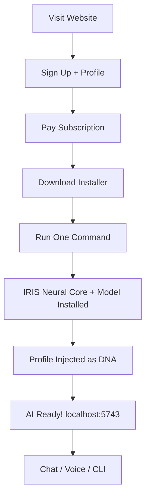

# Presentation & Demo Coordinator — Member 9

## Your Job
- Create the PowerPoint presentation
- Write the demo script
- Rehearse the presentation
- Explain project workflow during evaluation
- Create workflow diagrams and architecture visuals

---

## 1. Presentation Structure (12-15 Slides)

### Slide 1: Title Slide
- Project Name: **IRIS AI**
- Tagline: "Your AI, Your Privacy, Your Way"
- Team Members (all 10 names)
- College Name and Department

### Slide 2: Problem Statement
- Current AI assistants send data to cloud
- Privacy risks, internet dependency, no PC control
- Need for a truly personal, private AI

### Slide 3: Solution — IRIS AI
- 100% local AI assistant
- Zero data leaves your PC
- Full PC control + voice + CLI + web UI
- 3-tier memory that learns you

### Slide 4: Architecture Overview
- **Diagram:** 3-service architecture
  - Next.js Frontend → Browser
  - FastAPI Backend → Auth/Payments
  - Local AI Engine → IRIS Neural Core + ChromaDB
- Show the flow: User → Website → Download → Install → AI runs locally

### Slide 5: Technology Stack
| Layer | Technology |
|-------|-----------|
| Frontend | Next.js 14, React 18, TypeScript, Tailwind CSS |
| Backend | FastAPI, PostgreSQL, SQLAlchemy, JWT |
| AI Engine | IRIS Neural Core, LLaMA 3.2, ChromaDB, Whisper |
| Automation | PyAutoGUI, psutil, subprocess |
| Payments | Stripe, Razorpay |

### Slide 6: Key Feature — Clone System
- One base model → infinite clones
- Profile injection via installer
- Updates pushed without touching user data
- Every user gets a unique AI

### Slide 7: Key Feature — 3-Tier Memory
- **Short-term** → Session (RAM)
- **Long-term** → ChromaDB (vector search, auto-summarized)
- **Deep** → Permanent (encrypted JSON)
- Smart promotion at weight 5
- Instant deep memory for keywords

### Slide 8: Key Feature — PC Control
- Open/close apps
- File search and organization
- System monitoring (CPU/RAM)
- Screenshots, brightness, volume
- Web search, timers, Wi-Fi toggle

### Slide 9: Key Feature — Voice + CLI + UI
- **Web UI:** Beautiful dashboard at localhost:5743
- **CLI:** `ai "your command"` from any terminal
- **Voice:** Wake word "hey iris", fully offline Whisper STT

### Slide 10: User Flow


### Slide 11: Pricing
| Plan | Price | Key Features |
|------|-------|-------------|
| Free | ₹0 | Basic voice, short memory, 3 skills |
| Student Pro | ₹99/mo | Full memory, all skills, 6 themes |
| Lifetime | ₹999 | Everything forever + priority |

### Slide 12: Comparison Table
| Feature | ChatGPT | Siri | Alexa | IRIS |
|---------|---------|------|-------|-------|
| Local | ❌ | ❌ | ❌ | ✅ |
| Private | ❌ | ❌ | ❌ | ✅ |
| PC Control | ❌ | ❌ | ⚠️ | ✅ |
| Learns You | ⚠️ | ❌ | ❌ | ✅ |
| Offline | ❌ | ❌ | ❌ | ✅ |
| Affordable | ❌ | ❌ | ❌ | ✅ (₹999) |

### Slide 13: Demo Script
```
1. Open website → Show landing page
2. Login → Show dashboard
3. Show download page with install command
4. Run CLI: ai "hello"
5. Show memory: ai /memory
6. Show PC control: ai "system status"
7. Show skills: ai /skills
8. Open web dashboard at localhost:5743
```

### Slide 14: Challenges Faced
- Running LLM locally (IRIS Neural Core solved this)
- Voice recognition offline (Whisper solved this)
- Vector memory without cloud (ChromaDB solved this)
- Cross-platform installer (PowerShell + Bash solved this)

### Slide 15: Conclusion + Future Work
- We built a truly private, local AI assistant
- 3-tier memory, PC control, voice, CLI
- **Future:** Mobile app, more languages, custom model fine-tuning, plugin system

---

## 2. Demo Script Template

```
[Open browser → localhost:3000]
"Welcome to IRIS AI. This is the landing page where users
learn about the product and can sign up."

[Go to /pricing]
"Three plans: Free, Student Pro at ₹99/month, and Lifetime
at ₹999 — a one-time payment for permanent access."

[Login → Dashboard]
"This is the dashboard. It shows system status, memory stats,
and quick actions."

[Open Download page]
"One command installs everything — IRIS Neural Core, the AI model,
and your personal profile."

[Open Terminal]
"Let me show you the CLI. Type: ai 'hello'"
→ AI responds

"ai /memory"
→ Shows memory stats

"ai 'system status'"
→ Shows CPU, RAM, disk

"ai /skills"
→ Lists all available skills

[Open localhost:5743]
"This is the local web UI running directly on the user's machine.
Beautiful, fast, and completely private."
```

---

## 3. Deliverables

| File | Content | Due |
|------|---------|-----|
| `presentation.pptx` | PowerPoint file (15 slides) | Week 11 |
| `demo-script.md` | Walkthrough script for evaluators | Week 11 |
| `architecture-diagram.png` | 3-service architecture diagram | Week 6 |
| `user-flow-diagram.png` | User journey from signup to AI ready | Week 6 |
