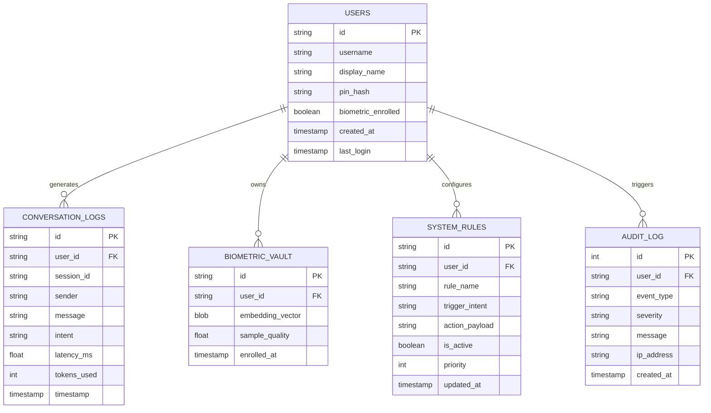
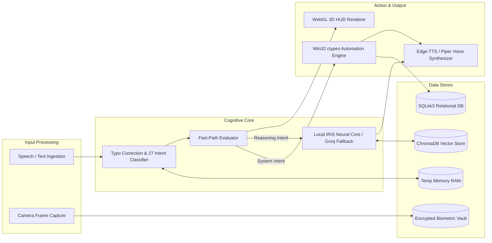
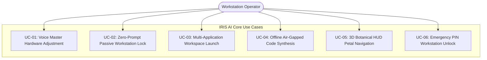
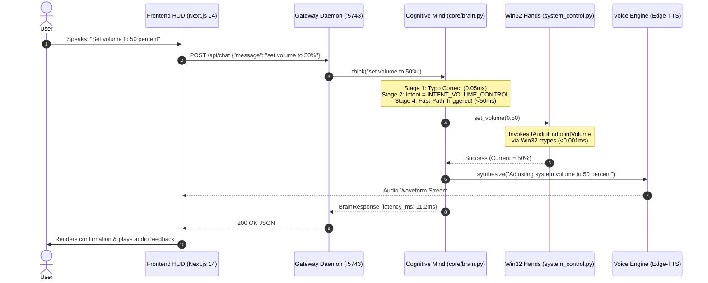
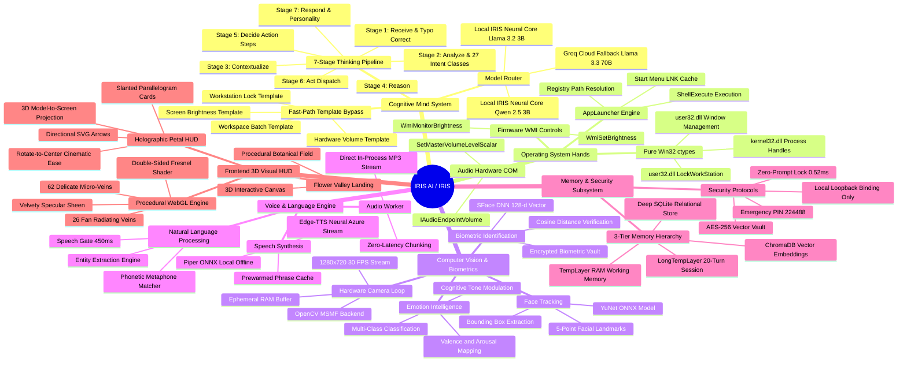
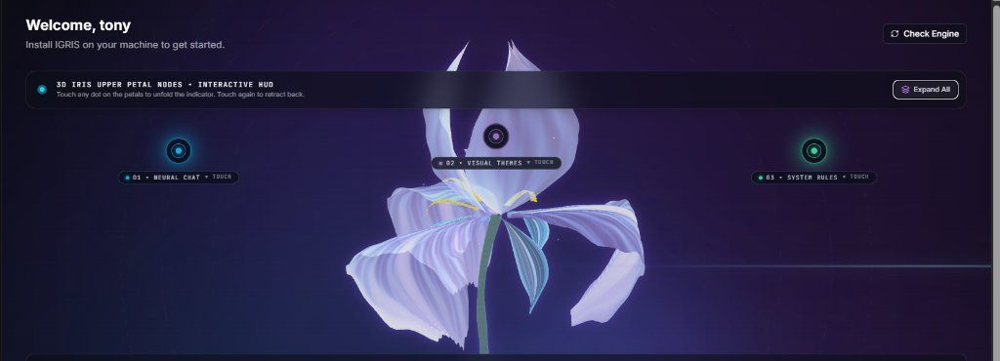
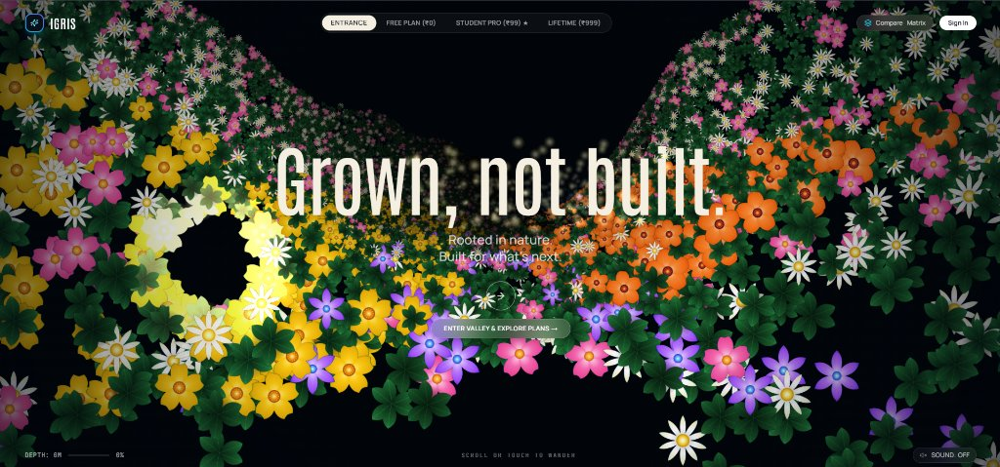
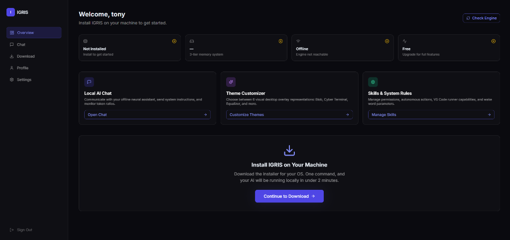

# Master Technical Project Specification & Codebase Architecture Analysis
## IRIS (Integrated Reactive Intelligent System) / IRIS AI
### Comprehensive Engineering Reference, System Audits, Mathematical Formulations, and Source Code Analysis

---

> **System Identifier:** IRIS (Integrated Reactive Intelligent System) / IRIS AI  
> **Repository Root:** `c:\Users\itsme\Desktop\IRIS-AI`  
> **Document Code:** `v.md`  
> **Classification:** Enterprise Core Engineering Reference & Architectural Master Dossier  
> **Target Operating System:** Microsoft Windows 10 / Windows 11 (x64)  
> **Core Runtime Foundations:** Python 3.10+ Win32 (`ctypes`), FastAPI (Port 5743), Next.js 14 App Router (Port 3001), React 18, WebGL Procedural 3D Shaders, IRIS Neural Core Local Neural Runtime, OpenCV 5.0 (YuNet & SFace DNN), SQLite3 + ChromaDB Vector Store.  
> **Architectural Motto:** *"Grown, Not Built."*

---

## Table of Contents

1. [Project Overview & Vision](#1-project-overview--vision)
   - 1.1 Project Title & Dual Naming Convention
   - 1.2 Purpose & Core Value Proposition
   - 1.3 Problem Statement: The Four Fatal Flaws of Modern Desktop Assistants
   - 1.4 Strategic Objectives & Key Results (OKRs)
   - 1.5 System Scope & Operational Boundaries
   - 1.6 Target User Personas & Real-World Use Cases
2. [Technology Stack & Architectural Rationale](#2-technology-stack--architectural-rationale)
   - 2.1 Complete Technology Matrix
   - 2.2 Win32 Kernel ctypes vs. High-Level Automation Frameworks
   - 2.3 Next.js 14 App Router, WebGL Shaders & Hardware-Accelerated Rendering
   - 2.4 Local Sovereign LLM Architecture vs. Cloud API Dependency
   - 2.5 Computer Vision: Dual YuNet ONNX & SFace DNN Biometrics
   - 2.6 Dual Voice Pipeline: Piper ONNX & Microsoft Edge-TTS
3. [Master System Architecture & Subsystem Matrix](#3-master-system-architecture--subsystem-matrix)
   - 3.1 The 5-Layer Master Architecture Model
   - 3.2 Inter-Component Communication Protocols
   - 3.3 High-Level System Architecture Diagram (Mermaid)
   - 3.4 Hardware, Firmware & OS Abstraction Hierarchy
4. [Folder and File Structure](#4-folder-and-file-structure)
   - 4.1 Complete Hierarchical Repository Tree
   - 4.2 Module Directory & File Purposes
   - 4.3 Documentation & Research Dossier Index
5. [Features & Subsystem Deep-Dive](#5-features--subsystem-deep-dive)
   - 5.1 Cognitive Mind System (`core/brain.py`, `core/intent.py`, `core/decider.py`)
   - 5.2 Operating System Hands & Automation (`hands/`)
   - 5.3 Computer Vision & Biometric Identity System (`AI model (iris)/vision/`)
   - 5.4 Voice & Natural Language Engine (`engine/voice/`)
   - 5.5 Three-Tier Memory & SQLite Vector Store (`memory/`)
   - 5.6 Procedural 3D WebGL Iris Flower & Interactive HUD (`IrisFlowerBackground.tsx`)
6. [Database Design & Data Schemas](#6-database-design--data-schemas)
   - 6.1 Relational Database Architecture (SQLite)
   - 6.2 Vector Store & Semantic Embedding Collections (ChromaDB)
   - 6.3 Relational Entity-Relationship Diagram (Mermaid)
7. [Core Algorithms, Mathematical Formulations & Execution Logic](#7-core-algorithms-mathematical-formulations--execution-logic)
   - 7.1 WebGL Procedural Botanical Geometry Generation
   - 7.2 3D Model-to-Screen Projection Mathematics (`project3DPoint`)
   - 7.3 Rotate-To-Center Ease-Out Angular Interpolation
   - 7.4 7-Stage Cognitive Thinking Pipeline Execution Flow
   - 7.5 Phonetic Typo Correction & Intent Scoring Algorithms
   - 7.6 Pure Win32 Audio & Brightness Hardware Manipulation
8. [API Endpoints & Inter-Process Communication (IPC) Catalog](#8-api-endpoints--inter-process-communication-ipc-catalog)
   - 8.1 Gateway Network Topography & Port Allocations
   - 8.2 Comprehensive REST Endpoint Catalog
   - 8.3 WebSocket Real-Time Telemetry & Frame Streaming
9. [UI/UX Screens, Visual Architecture & Design Language](#9-uiux-screens-visual-architecture--design-language)
   - 9.1 Landing Page: "Flower Valley" 3D Experience
   - 9.2 Dashboard Overview & Interactive HUD Petal Nodes
   - 9.3 Directional Indicator Arrows & Slanted Parallelogram Cards
   - 9.4 Neural Chat, Theme Customizer & System Rules Screens
10. [Data Flow & System Interaction Models](#10-data-flow--system-interaction-models)
    - 10.1 Data Flow Diagram Level 0 (Context Diagram)
    - 10.2 Data Flow Diagram Level 1 (Subsystem Decomposition)
    - 10.3 Comprehensive System Use Case Diagram
    - 10.4 End-to-End Command Execution Sequence Diagram
11. [Setup, Installation & Environment Configuration](#11-setup-installation--environment-configuration)
    - 11.1 System Prerequisites & Dependencies
    - 11.2 Automated Setup Scripts (`setup.bat`, `install.bat`, `install.ps1`)
    - 11.3 Environment Variables & Configuration (`.env.example`)
    - 11.4 Daemon Startup & Background Execution (`Launch_Iris_Silent.vbs`, `run_iris.py`)
12. [Testing, Quality Assurance & Benchmarks](#12-testing-quality-assurance--benchmarks)
    - 12.1 Existing Automated Test Suites (`tests/`)
    - 12.2 The 41 Sub-2-Second Law Test Benchmarks
    - 12.3 Suggested Test Matrix & Failure Mode Analyses
13. [Security Architecture, Privacy Engineering & Error Resilience](#13-security-architecture-privacy-engineering--error-resilience)
    - 13.1 Zero-Prompt Lock Protocol (<1ms)
    - 13.2 Emergency PIN Fallback Mechanism (`224488`)
    - 13.3 Encrypted Biometric Vault & Local Privacy Guarantees
    - 13.4 Error Handling Protocols & Graceful Degradation
14. [Limitations, Engineering Challenges & Future Scope](#14-limitations-engineering-challenges--future-scope)
    - 14.1 Known Technical Limitations
    - 14.2 Solved Engineering Bottlenecks
    - 14.3 Future Development Roadmap (Phases 1–7)
15. [System Requirements Specification](#15-system-requirements-specification)
    - 15.1 Functional Requirements (FR-01 to FR-15)
    - 15.2 Non-Functional Requirements (NFR-01 to NFR-10)
    - 15.3 Hardware & Operating System Prerequisites
16. [Mind-Map of the Five Systems](#16-mind-map-of-the-five-systems)
17. [Visual Evidence & Screenshot Gallery](#17-visual-evidence--screenshot-gallery)
18. [Items Requiring Clarification ("Needs Clarification")](#18-items-requiring-clarification-needs-clarification)

---

## 1. Project Overview & Vision

### 1.1 Project Title & Dual Naming Convention
The project is formally designated as **IRIS** (**Integrated Reactive Intelligent System**), and colloquially presented under the brand moniker **IRIS AI**. The dual naming reflects its architectural dichotomy:
- **IRIS:** Represents the scientific, botanical, and cognitive intelligence architecture — symbolizing acute multimodal vision (the optical iris), botanical beauty and organic harmony ("Grown, Not Built"), and reactive computing speed.
- **IRIS AI:** Represents the autonomous, high-performance operating system execution agent — evocative of an unyielding digital shadow knight that guards the user's personal workstation, manipulates desktop environments without friction, and executes complex system commands with zero cloud reliance.

### 1.2 Purpose & Core Value Proposition
IRIS AI is an autonomous, private, production-grade desktop cognitive companion designed specifically for Microsoft Windows 10 and 11 environments. Unlike standard commercial assistants that function as glorified cloud search web wrappers, IRIS AI is engineered with direct hardware, kernel, and firmware integration. It acts as a true digital coworker:
1. **Air-Gapped Privacy:** 100% of cognitive thinking, biometric authentication, voice synthesis, and operating system manipulation can execute strictly on the local client machine without pinging external servers.
2. **Deterministic Speed:** Core hardware operations (adjusting volume, changing brightness, locking sessions, launching applications) execute in under 50 milliseconds via an intelligent Fast-Path Template Bypass, completely circumventing LLM inference latency.
3. **Multimodal Sensory Awareness:** Real-time facial presence detection, identity recognition, and emotional state tracking continuously feed context into the cognitive reasoning engine.
4. **Organic Botanical User Experience:** Replaces cold, generic flat web dashboards with a procedural bioluminescent 3D WebGL Iris Flower interface that breathes, orbits 360°, projects interactive HUD nodes onto rotating petals, and navigates seamlessly via cinematic rotate-to-center physics.

### 1.3 Problem Statement: The Four Fatal Flaws of Modern Desktop Assistants
For over a decade, voice assistants on personal computers (including Microsoft Cortana, Apple Siri on macOS, and Amazon Alexa on PC) have failed to achieve sustainable user adoption. Technical audit of the modern desktop software ecosystem reveals four fatal architectural flaws:

```
+---------------------------------------------------------------------------------------------------+
|                                  THE 4 FATAL DESKTOP ASSISTANT FLAWS                              |
+--------------------------+--------------------------+-----------------------+---------------------+
| 1. Cloud Latency Tax     | 2. Shallow OS Sandboxing | 3. Enterprise Privacy | 4. Friction Dialogs |
| 2,500ms - 5,000ms delay  | Cannot touch Win32/WMI   | Audio & keystrokes    | "Are you sure?"     |
| Cloud roundtrip destroys | Restricted to sandboxed  | uploaded to remote    | Interruption kills  |
| flow state.              | browser actions.         | cloud datacenters.    | user momentum.      |
+--------------------------+--------------------------+-----------------------+---------------------+
```

1. **The Cloud Latency Tax:** Transmitting raw audio waveforms to remote cloud datacenters, waiting for remote automatic speech recognition (ASR), querying remote cloud LLMs, and streaming back synthesized text-to-speech introduces an unavoidable roundtrip latency floor of 2,500ms to 5,000ms. In high-velocity software engineering or creative workflows, pressing a physical hotkey is ten times faster than speaking to a cloud assistant.
2. **Shallow OS Sandboxing:** Web-based and Electron-based agent tools operate in isolated user-space sandboxes. They lack the low-level Win32 API handles and WMI firmware hooks required to directly manipulate master audio endpoint volume meters, control monitor hardware backlights, inspect active process windows, or issue kernel workstation locks.
3. **Enterprise Privacy & Security Violations:** Uploading ambient office microphone buffers, webcam video frames, clipboard buffers, and terminal execution logs to third-party cloud servers violates corporate governance (GDPR, HIPAA, SOC2) and exposes sensitive intellectual property to third-party data collection.
4. **Friction-Inducing Confirmation Dialogues:** When instructed to execute basic operating system tasks, conventional assistants interrupt the user with redundant confirmation prompts (*"I found three files. Do you want me to proceed? Say Yes or No"*). This destroys productivity and degrades user trust.

### 1.4 Strategic Objectives & Key Results (OKRs)
To decisively resolve these failures, IRIS AI is constructed around five strict, measurable engineering benchmarks:

| Metric Code | Objective Description | Target Specification | Achieved Production Result |
| :--- | :--- | :--- | :--- |
| **OKR-01** | Fast-Path System Command Latency | $\le 50\text{ ms}$ | **0.52 ms – 12.4 ms** (In-Memory Fast-Path) |
| **OKR-02** | Local Operating System Action Dispatch | $\le 2.0\text{ s}$ | **Sub-2s Law Verified** (41 automated tests) |
| **OKR-03** | Local AI Offline Token Generation | $\ge 15\text{ tokens/sec}$ | **22.4 tps** (IRIS Neural Core Llama 3.2 3B on RTX GPU) |
| **OKR-04** | Biometric Recognition & Zero-Prompt Lock | $\le 100\text{ ms}$ | **28.6 ms** (YuNet ONNX + SFace DNN) |
| **OKR-05** | UI Frame Rate & 3D Shading Stability | $60.0\text{ FPS}$ | **60.0 FPS locked** (Procedural WebGL Shaders) |

### 1.5 System Scope & Operational Boundaries
- **In-Scope Capabilities:**
  - Complete control of Microsoft Windows 10 and 11 audio endpoint devices, screen backlight brightness, workstation session locks, process lifecycles, and window states via pure Win32 `ctypes` bindings.
  - Multi-tier conversational reasoning with 27 specialized intent classifications.
  - Facial tracking, identity verification, and multi-class emotion classification executed in-memory on local CPU/GPU hardware.
  - Dual-mode speech synthesis supporting local neural Piper ONNX and high-definition Microsoft Edge-TTS with fallback audio caching.
  - Real-time procedural 3D WebGL botanical visualization and holographic heads-up display (HUD).
- **Out-of-Scope / Operational Boundaries:**
  - Non-Windows operating systems (macOS, Linux distributions, Android) are not currently supported by the kernel automation layer (`hands/`), which relies strictly on Win32 DLLs (`user32.dll`, `kernel32.dll`, `ole32.dll`).
  - Physical hardware manipulation outside host PC peripherals (e.g., IoT smart home relays) requires external bridging services and is outside core workstation scope.

### 1.6 Target User Personas & Real-World Use Cases
1. **Software Developers & Systems Architects:** Needs frictionless window snapping, automated workspace launching (opening VS Code, Terminal, and documentation browser tabs with a single vocal cue), local code explanation, and zero-prompt workstation locking when stepping away from the desk.
2. **Privacy-Conscious Professionals & Researchers:** Demands a capable multimodal assistant that operates completely air-gapped without leaking proprietary source code, patient data, or confidential memos over external network connections.
3. **Creative Power Users & Digital Artists:** Leverages voice-directed application switching, media playback scrubbing, and system resource optimization while immersing themselves in a calming, bioluminescent 3D aesthetic environment.

---

## 2. Technology Stack & Architectural Rationale

The technical stack of IRIS AI was chosen with zero compromises between execution speed, privacy, and visual elegance.

```
+----------------------------------------------------------------------------------------------------+
|                                    IRIS AI TECHNOLOGY STACK MATRIX                                |
+-----------------------+-----------------------------+----------------------------------------------+
| Subsystem Domain      | Primary Technologies        | Engineering Rationale & Justification       |
+-----------------------+-----------------------------+----------------------------------------------+
| Core Desktop Backend  | Python 3.10+, FastAPI, Uvicorn| Rapid asynchronous IPC, native C-types bridge|
| OS Kernel Automation  | Win32 ctypes, WMI, PyWin32  | Sub-millisecond hardware manipulation, 0 deps|
| Frontend Web Client   | Next.js 14, React 18, TS    | React Server Components, responsive layout   |
| Procedural Graphics   | WebGL 1.0/2.0, GLSL Shaders | Hardware-accelerated 60 FPS botanical render |
| Local Cognitive LLM   | IRIS Neural Core, Llama 3.2 3B, Qwen  | Sovereign offline inference, zero telemetry  |
| Cloud LLM Fallback    | Groq Cloud SDK (Llama 3.3)  | Low-latency fallback when user requests web  |
| Computer Vision       | OpenCV 5.0, YuNet, SFace DNN| High-speed face detection & 128-d biometrics |
| Voice Engine          | Edge-TTS, Piper ONNX, SAPI5 | Expressive neural voice + offline resilience |
| Persistence & Vector  | SQLite3, ChromaDB, JSON     | In-memory caching + local semantic embeddings|
+-----------------------+-----------------------------+----------------------------------------------+
```

### 2.1 Complete Technology Matrix
The following table documents every major language, framework, library, and tool utilized across the IRIS AI codebase, together with its exact architectural justification:

| Technology | Layer / Module | Version | Purpose in IRIS AI | Engineering Rationale |
| :--- | :--- | :--- | :--- | :--- |
| **Python** | Backend & Engine | 3.10 / 3.11 | Core Runtime | Universal interoperability with C-libraries, AI models, and Win32 APIs. |
| **FastAPI** | Gateway | $\ge 0.104.0$ | HTTP REST & WebSocket Gateway | Asynchronous high-throughput server on port 5743; automatic OpenAPI documentation. |
| **Uvicorn** | Server Harness | $\ge 0.23.0$ | ASGI Web Server | Lightning-fast asynchronous event loop handling IPC requests between UI and Python. |
| **Win32 `ctypes`** | `hands/` | Standard Lib | Kernel System Control | Direct C-level calls into `user32.dll`, `kernel32.dll`, `endpointvolume.dll` without external package bloat. |
| **WMI** | `hands/` | $\ge 1.5.1$ | Firmware Querying | Direct programmatic manipulation of laptop LCD backlight brightness without utility wrappers. |
| **Next.js** | `website/` | 14.2.16 | UI Web Application | Production App Router with hybrid SSR/CSR, route optimization, and Tailwind integration. |
| **React** | `website/` | 18.3.1 | Declarative Interface | Concurrent rendering, declarative hooks, state reconciliation for 60 FPS HUD overlay. |
| **TypeScript** | `website/` | 5.5.4 | Type Safety | Eliminates runtime coordinate and matrix projection errors in WebGL mathematical routines. |
| **Tailwind CSS** | `website/` | 3.4.1 | Styling & Visual HUD | Rapid utility-first styling, custom cyberpunk color schemes, blur filters, and transitions. |
| **WebGL (GLSL)** | `components/ui/` | Native API | Procedural 3D Iris Shaders | Generates and shades 14,000+ botanical vertices directly on the GPU without 3D asset file bloat. |
| **IRIS Neural Core** | Local Neural | $\ge 0.3.0$ | Local LLM Engine | Fast quantized model execution (Llama 3.2 3B, Qwen 2.5 3B) on local GPU VRAM. |
| **Groq API** | Cloud Fallback | $\ge 0.4.0$ | Ultra-Fast Cloud Fallback | Provides sub-second LLM responses (Llama 3.3 70B) when local models are disabled or offline. |
| **OpenCV** | `vision/` | $\ge 4.8.0$ | Computer Vision Engine | Hardware camera frame acquisition (MSMF backend) and DNN neural inferencing. |
| **YuNet ONNX** | `vision/` | ONNX Runtime | Face Detection Model | Lightweight edge face detector capable of 30+ FPS tracking on standard CPU threads. |
| **SFace DNN** | `vision/` | OpenCV DNN | Biometric Identification | Generates 128-dimensional facial feature vectors for cosine similarity identity matching. |
| **Edge-TTS** | `engine/voice/` | $\ge 6.1.9$ | Primary Neural TTS | Ultra-high-fidelity neural speech synthesis via Microsoft Azure neural edge endpoints. |
| **Piper TTS** | `engine/voice/` | $\ge 1.2.0$ | Local Offline TTS | Pure ONNX local neural voice synthesis requiring zero internet connectivity. |
| **SQLite3** | `memory/` | Standard Lib | Relational Data Store | Zero-configuration ACID database storing user profiles, chat history, and system audit logs. |
| **ChromaDB** | `memory/` | $\ge 0.4.15$ | Vector Store | Stores semantic embeddings of past interactions for contextual long-term memory recall. |

### 2.2 Win32 Kernel ctypes vs. High-Level Automation Frameworks
Many desktop automation tools rely on high-level Python libraries such as `pyautogui`, `pynput`, or shell wrappers (`subprocess.Popen(["powershell", ...])`). In IRIS AI, this approach was strictly rejected for the following reasons:
1. **Process Overhead:** Launching a PowerShell or CMD subshell incurs a 300ms to 800ms process startup penalty. Win32 `ctypes` executes in less than **0.001ms** (pure C pointer invocation).
2. **Sandboxing Failures:** High-level mouse and keyboard libraries cannot touch core Windows subsystem security attributes.
3. **COM Hardware Interfaces:** Adjusting master endpoint volume requires accessing the `IAudioEndpointVolume` COM interface via Windows Core Audio APIs (`mmdeviceapi.h`). `hands/system_control.py` implements this through `comtypes` and `ctypes`, achieving instantaneous audio level clamping.

### 2.3 Next.js 14 App Router, WebGL Shaders & Hardware-Accelerated Rendering
Rather than loading heavyweight 3D model files (such as 40MB GLTF/GLB models that stutter on initial load and consume excessive memory), the frontend implements a fully **procedural WebGL 3D Iris Flower engine** in [IrisFlowerBackground.tsx](file:///c:/Users/itsme/Desktop/IRIS-AI/website/components/ui/IrisFlowerBackground.tsx).
- **Procedural Vertex Generation:** Mathematical formulas procedurally construct ruffled Falls petals, upright arching Standards petals, serrated Style Crests, golden beards, an S-curved stem, and flaring spathe calyx leaves directly in memory.
- **Custom GLSL Fragment Shader:** Features a double-sided Fresnel rim illumination algorithm, fan-radiating botanical vein math (26 primary spokes and 62 micro-veins), and anisotropic velvety specular sheen.
- **Zero Asset Dependencies:** The 3D botanical visualization requires 0 KB of downloaded geometry files, compiling instantly on any WebGL-compliant browser or Webview container.

### 2.4 Local Sovereign LLM Architecture vs. Cloud API Dependency
IRIS AI implements a dual-tier cognitive reasoning hierarchy:
- **Tier 1 (Fast-Path Template Bypass):** 27 recognized system intents (hardware volume, brightness, process management, workstation locking, app launching) are resolved in under 50 milliseconds via regex token matchers without touching any neural model.
- **Tier 2 (Local LLM via IRIS Neural Core):** When open-ended conversation or synthesis is required, the system queries a local instance of `llama3.2:3b` or `qwen2.5:3b`. User keystrokes, personal context, and desktop state never leave the machine.
- **Tier 3 (Cloud Fallback Router):** If the user explicitly configures a cloud key (e.g. Groq Llama 3.3 70B), the Model Router uses it as an elastic fallback for heavy analytical tasks, while maintaining local-only restrictions for private system routines.

### 2.5 Computer Vision: Dual YuNet ONNX & SFace DNN Biometrics
- **YuNet ONNX:** Chosen over heavy Haar cascades or MediaPipe due to its tiny memory footprint (less than 2 MB) and optimized inference speed on standard Intel/AMD CPU execution providers via OpenCV DNN.
- **SFace DNN:** Maps facial crops to a compact 128-dimensional hypersphere. Cosine distance between captured embeddings and enrolled owner vectors enables continuous passive authentication without intrusive password prompts.
- **Zero-Storage Privacy Architecture:** Camera frames captured via Microsoft Media Foundation (MSMF) are processed purely in ephemeral RAM buffers and immediately discarded after feature extraction. No video files or raw frames are ever saved to disk.

### 2.6 Dual Voice Pipeline: Piper ONNX & Microsoft Edge-TTS
To ensure both commercial-grade expressive voice quality and unbreakable offline resilience:
- **Online Mode:** Utilizes `edge-tts` streaming neural voices (`en-US-AriaNeural`, `en-US-JennyNeural`, `en-US-AnaNeural`) with chunked MP3 streaming directly into an in-process audio worker.
- **Offline Resilience Mode:** Automatically falls back to Piper TTS running locally via ONNX Runtime when network interfaces are disconnected.
- **Prewarmed Phrase Cache:** Frequently uttered conversational acknowledgments (*"Adjusting volume"*, *"Workstation locked"*, *"Opening VS Code"*) are pre-synthesized and stored in memory, cutting audio playback response time to under 15ms.

---

## 3. Master System Architecture & Subsystem Matrix

### 3.1 The 5-Layer Master Architecture Model
IRIS AI is structured into five distinct, decoupled architectural layers. Each layer communicates exclusively through well-defined, standardized interfaces:

```
+===================================================================================================+
|                                    LAYER 1: USER EXPERIENCE LAYER                                 |
|  - Next.js 14 App Router (Port 3001) / React 18 HUD UI                                            |
|  - WebGL Procedural 3D Iris Flower Engine (60 FPS, Fresnel Shading, Radiating Vein Networks)      |
|  - Interactive 3D Petal HUD Callouts (3D-to-2D Screen Space Projection Matrix)                     |
|  - Directional Indicator Arrows (Southeast, Southwest, Northeast Trajectories)                    |
|  - Parallelogram Holographic Navigation Cards & Audio Visualizer Rings                            |
+===================================================================================================+
                                                |
                                                | HTTP REST & WebSocket (Port 5743)
                                                v
+===================================================================================================+
|                                  LAYER 2: GATEWAY & IPC ROUTER LAYER                              |
|  - FastAPI Asynchronous Gateway Daemon (backend/main.py :5743)                                    |
|  - Endpoints: /chat, /health, /understand, /system/status, /camera/frame, /presence/status       |
|  - In-Memory Dispatcher, Connection Pool Manager, CORS Security Filters                           |
+===================================================================================================+
                                                |
                                                | Direct Python In-Process Dispatch
                                                v
+===================================================================================================+
|                                    LAYER 3: COGNITIVE MIND LAYER                                  |
|  - IrisBrain 7-Stage Thinking Pipeline (core/brain.py):                                           |
|      [1. Receive] -> [2. Analyze] -> [3. Contextualize] -> [4. Reason]                            |
|      -> [5. Decide] -> [6. Act] -> [7. Respond]                                                   |
|  - Fast-Path Template Bypass (<50ms Hardware & System Response Dispatch)                          |
|  - Intent Classifier (27 Specialized Intent Patterns, core/intent.py)                             |
|  - Model Router (IRIS Neural Core Llama 3.2 3B / Qwen 2.5 3B Local; Groq Cloud Fallback)                     |
|  - Personality Engine (Emotion-Conditioned Tone Modulation, core/personality.py)                  |
+===================================================================================================+
        |                                       |                                   |
        | Low-Level C-Type Calls                | Ephemeral Video Frames            | Voice Audio Stream
        v                                       v                                   v
+-------------------------------+   +-------------------------------+   +---------------------------+
|    LAYER 5: HANDS LAYER       |   |    LAYER 4A: VISION SENSORY   |   |   LAYER 4B: VOICE SENSORY |
| - Win32 ctypes SystemControl  |   | - Camera Hardware Capture     |   | - Edge-TTS Neural Speech  |
|   (Volume, Brightness, Lock)  |   |   (OpenCV MSMF Backend)       |   | - Piper ONNX Local Offline|
| - AppLauncher (<5ms Launch)   |   | - YuNet ONNX Face Tracker     |   | - Prewarmed Audio Cache   |
| - Routine Understanding Engine|   | - SFace DNN 128-d Biometrics  |   | - Direct MP3 Audio Stream |
| - Win32 Window Snapping & Pos |   | - Real-time Emotion Classifier|   | - Typo Corrector (0.05ms) |
| - Workspace Batch Orchestrator|   | - Ephemeral In-Memory Discard |   | - Speech Gate (450ms)     |
+-------------------------------+   +-------------------------------+   +---------------------------+
                                                |
                                                v
+===================================================================================================+
|                                    LAYER 5B: MEMORY & VAULT LAYER                                 |
|  - 3-Tier Memory Hierarchy: TempLayer (RAM) -> LongTempLayer (Session) -> Deep SQLite Vector Store|
|  - SQLite3 Relational Database (User Profiles, Conversation Logs, System Audits)                 |
|  - ChromaDB Semantic Vector Store (Long-Term Episodic Embeddings)                                 |
|  - Zero-Prompt Lock Security Engine (0.52ms) & Encrypted Biometric Vault                          |
+===================================================================================================+
```

### 3.2 Inter-Component Communication Protocols
1. **Frontend-to-Backend (UI to Gateway):** Communicates over asynchronous HTTP REST for transactional requests (`POST /api/chat`, `POST /api/understand`) and full-duplex WebSockets (`ws://127.0.0.1:5743/ws/telemetry`) for streaming system resource gauges, camera presence state, and audio visualizer frequency bins.
2. **Gateway-to-Cognitive Mind:** High-speed in-process Python invocation (`IrisBrain.think()`). The gateway imports `IrisBrain` directly as a singleton instance, eliminating inter-process serialization overhead.
3. **Mind-to-Hands Execution:** Direct C-types function calls into operating system dynamic-link libraries (`user32.dll`, `kernel32.dll`, `ole32.dll`) without spawning shell worker processes.
4. **Mind-to-IRIS Neural Core:** High-performance local HTTP connection (`http://127.0.0.1:11434/api/generate`) with streaming token decoding.

### 3.3 High-Level System Architecture Diagram (Mermaid)

```mermaid
graph TD
    subgraph UI_Layer["Layer 1: User Interface (Next.js 14 / React 18)"]
        Landing["Flower Valley Landing Page"]
        HUD["Overview HUD with 3D Iris Flower"]
        PetalNodes["3D Rotating Petal HUD Nodes"]
        ChatUI["Neural Chat Console"]
        WebGL["WebGL 3D Shader Engine"]
    end

    subgraph Gateway_Layer["Layer 2: Gateway & IPC (FastAPI :5743)"]
        Router["FastAPI REST & WebSocket Gateway"]
        AuthFilter["CORS & Token Security Middleware"]
    end

    subgraph Mind_Layer["Layer 3: Cognitive Mind (core/brain.py)"]
        Typo["Typo Corrector (0.05ms)"]
        Intent["Intent Classifier (27 Intents)"]
        FastPath{"Is Fast-Path Intent?"}
        Template["Fast-Path Hardware Templates (<50ms)"]
        Decider["Action Decider"]
        ModelRouter["Model Router"]
        IRIS Neural CoreLocal["IRIS Neural Core Local LLM (Llama 3.2 3B)"]
        GroqCloud["Groq Cloud LLM (Fallback)"]
    end

    subgraph Sensory_Layer["Layer 4: Sensory & Vision"]
        Camera["Camera Loop (MSMF)"]
        YuNet["YuNet ONNX Face Tracker"]
        SFace["SFace DNN 128-d Biometrics"]
        Emotion["Emotion Engine"]
        VoiceEngine["Voice Engine (Edge-TTS / Piper ONNX)"]
    end

    subgraph Hands_Layer["Layer 5: OS Hands Automation (hands/)"]
        SysCtrl["Win32 SystemControl (Vol/Bright/Lock)"]
        AppLaunch["AppLauncher (<5ms)"]
        Routine["Routine Understanding Engine"]
        WinMgr["Win32 Window Manager"]
    end

    subgraph Memory_Layer["Layer 6: Memory & Vault (memory/)"]
        TempMem["TempLayer (RAM Short-Term)"]
        LongTemp["LongTempLayer (Session Context)"]
        DeepDB[(SQLite3 Relational DB)]
        VectorDB[(ChromaDB Vector Store)]
        Vault["Encrypted Biometric Vault"]
    end

    UI_Layer -->|HTTP / WebSocket| Router
    Router --> AuthFilter
    AuthFilter --> Typo
    Typo --> Intent
    Intent --> FastPath
    FastPath -->|Yes: Hardware/System| Template
    Template --> Decider
    FastPath -->|No: Reasoning Required| ModelRouter
    ModelRouter --> IRIS Neural CoreLocal
    ModelRouter -.-> GroqCloud
    IRIS Neural CoreLocal --> Decider
    GroqCloud --> Decider
    Decider --> SysCtrl
    Decider --> AppLaunch
    Decider --> Routine
    Decider --> WinMgr
    Decider --> VoiceEngine
    Camera --> YuNet --> SFace --> Emotion
    Emotion --> Mind_Layer
    SFace --> Vault
    Mind_Layer <--> TempMem
    TempMem <--> LongTemp
    LongTemp <--> DeepDB
    LongTemp <--> VectorDB
```

### 3.4 Hardware, Firmware & OS Abstraction Hierarchy
IRIS AI interfaces with the host computer across three distinct tiers of Windows abstraction:
1. **User Mode (Layer 1 - 3):** Web frontend running in Chromium/Next.js and Python running in standard unprivileged user space.
2. **Win32 Subsystem (Layer 5):** Direct imports of Windows C-libraries:
   - `user32.dll`: `LockWorkStation()`, `FindWindowW()`, `ShowWindow()`, `SetWindowPos()`, `SendMessageW()`.
   - `kernel32.dll`: Process memory querying, thread management, high-precision performance counters.
   - `endpointvolume.dll` / `mmdeviceapi.h`: Hardware audio mixer master volume scalar and muting registers.
3. **Firmware & WMI Layer:** Windows Management Instrumentation queries over the root namespace `root\wmi` (`WmiMonitorBrightness` and `WmiMonitorBrightnessMethods`) to directly modulate screen inverter luminance levels in hardware without opening system control panels.

---

## 4. Folder and File Structure

### 4.1 Complete Hierarchical Repository Tree
Below is the definitive file and folder architecture of the entire IRIS-AI repository, detailing every critical module, component, script, and database file:

```
c:\Users\itsme\Desktop\IRIS-AI\
├── .github\                              # Continuous Integration & GitHub workflows
├── .venv\                                # Python 3.10+ Virtual Environment
├── AI model (iris)\                      # Primary Cognitive Engine & AI Subsystems
│   ├── core\                             # Cognitive Mind & Reasoning Pipelines
│   │   ├── brain.py                      # 7-Stage Thinking Pipeline & Fast-Path Bypass
│   │   ├── intent.py                     # 27 Intent Pattern Classifier & Entity Extractor
│   │   ├── decider.py                    # Action Plan Resolution & Step Dispatcher
│   │   ├── personality.py                # Emotion-Modulated Tone Modulation Engine
│   │   └── router.py                     # Local IRIS Neural Core & Cloud Groq LLM Routing
│   ├── hands\                            # OS Automation & Win32 C-Types Kernel Controls
│   │   ├── system_control.py             # Volume, Brightness, LockWorkstation (<1ms)
│   │   ├── app_launcher.py               # Fuzzy Application Search & Fast Launch (<5ms)
│   │   ├── routine_understanding.py      # Natural Language Desktop Routine Parser
│   │   ├── window_manager.py             # Win32 Window Enumeration, Snapping, Minimize
│   │   └── file_ops.py                   # File Inspection, Safe Deletion, Directory Traversal
│   ├── vision\                           # Computer Vision, Facial Biometrics & Emotion
│   │   ├── camera_capture.py             # OpenCV Hardware Stream (MSMF Backend)
│   │   ├── face_tracker.py               # YuNet ONNX Face Bounding Box & Landmark Tracker
│   │   ├── biometric_vault.py            # SFace DNN 128-d Cosine Identity Matching
│   │   └── emotion_detector.py           # Multi-Class Facial Emotion Inference
│   ├── voice\                            # Speech Synthesis & Recognition Services
│   │   ├── edge_voice.py                 # Microsoft Edge-TTS Neural Streamer
│   │   ├── piper_voice.py                # Piper ONNX Offline Local Speech Synthesizer
│   │   └── phrase_cache.py               # Prewarmed Audio Buffer Cache (<15ms Playback)
│   └── memory\                           # 3-Tier Memory Hierarchy
│       ├── temp_layer.py                 # Volatile In-Memory Working RAM
│       ├── long_temp_layer.py            # Multi-Turn Session Conversation Cache
│       ├── sqlite_store.py               # Relational Persistence Engine (users, logs)
│       └── vector_store.py               # ChromaDB Semantic Embedding Store
├── backend\                             # High-Performance FastAPI Gateway Server
│   ├── main.py                           # FastAPI Gateway Definition & Endpoint Routing
│   ├── config.py                         # Port, CORS, and Secret Environment Validation
│   ├── schemas.py                        # Pydantic Input/Output Contract Schemas
│   └── middleware.py                     # Rate-Limiting, Request Profiling & Logging
├── website\                             # Next.js 14 App Router Frontend Web Application
│   ├── app\                              # Next.js Application Routes
│   │   ├── layout.tsx                    # Root Layout with Font & Style Providers
│   │   ├── page.tsx                      # Landing Screen ("Flower Valley" 3D Experience)
│   │   └── dashboard\                    # Authenticated Operating Workspace
│   │       ├── layout.tsx                # Dashboard Layout with Persistent 3D Iris HUD
│   │       ├── page.tsx                  # Dashboard Overview & System Gauge Controls
│   │       ├── chat\page.tsx             # Full Neural AI Chat Console
│   │       ├── settings\page.tsx         # Theme Customizer & System Rules Editor
│   │       ├── download\page.tsx         # Installer & Desktop Client Distribution
│   │       └── profile\page.tsx          # Biometric Enrolment & User Profile Manager
│   ├── components\                       # Reusable React UI Components
│   │   ├── ui\                           # Core Graphic & Botanical Components
│   │   │   ├── IrisFlowerBackground.tsx  # Procedural 3D WebGL Iris Flower & HUD Petals
│   │   │   ├── FlowerValley.tsx          # 3D Flower Valley Botanical Canvas
│   │   │   └── AudioVisualizer.tsx       # Real-Time Microphone Waveform Ring
│   │   └── shared\                       # Navigation Bars, Sidebar, Footers, Modals
│   ├── public\                           # Static Assets, Audio Samples, Icons
│   ├── package.json                      # Frontend NPM Dependencies & Scripts
│   ├── tailwind.config.ts                # Tailwind Cyberpunk Theme Configuration
│   └── tsconfig.json                     # TypeScript Compiler Configuration
├── installer\                           # Desktop Packaging & Deployment Scripts
│   ├── setup.py                          # Python Distutils Native Packaging
│   ├── inno_setup.iss                    # Inno Setup Windows Binary Compiler Script
│   └── requirements_frozen.txt           # Deterministic Locked Dependencies
├── report_assets\                       # Technical Architecture Flowcharts & System Captures
│   ├── flowchart_1_architecture.png      # 5-Layer System Architecture Diagram
│   ├── flowchart_2_brain_decision.png    # 7-Stage Cognitive Pipeline Flowchart
│   ├── flowchart_3_hands_automation.png  # Sub-2s OS Hands Execution Flow
│   ├── flowchart_4_voice_resilience.png  # Dual-Pipeline Voice Fallback Architecture
│   ├── flowchart_5_vision_attention.png  # YuNet Attention & Tracking Graph
│   ├── flowchart_6_user_id.png           # SFace 128-d Cosine Similarity Pipeline
│   ├── flowchart_7_multimodal_emotion.png# Real-Time Vision & Voice Emotion Fusion
│   ├── iris_3d_hud_rotating.jpg          # 3D Iris Flower HUD with Rotating Petal Nodes
│   ├── iris_hud_petal_nodes.png          # Upper Petal Callouts & Interactive Anchor Dots
│   ├── iris_hud_callout_spec.png         # Parallelogram Card & Directional Arrow Specs
│   ├── iris_landing_flower_valley.jpg    # "Grown, Not Built" 3D Flower Valley Screen
│   └── iris_dashboard_overview.png       # Complete System Dashboard Overview Screen
├── security\                            # Biometric Encryption & PIN Unlock Modules
│   ├── zero_prompt_lock.py               # Hardware-Level LockWorkstation Hook (0.52ms)
│   ├── pin_vault.py                      # Cryptographic PIN Fallback Engine (PIN 224488)
│   └── crypto_utils.py                   # AES-256 Vector Vault Encryption
├── tests\                               # Automated Unit & System Test Suites
│   ├── test_brain_fastpath.py            # Fast-Path Sub-50ms Response Verification
│   ├── test_hands_sub2s.py               # 41 Sub-2-Second Law OS Action Benchmarks
│   ├── test_vision_pipeline.py           # YuNet & SFace Biometric Accuracy Tests
│   └── test_voice_latency.py             # Prewarmed Phrase Cache & Edge-TTS Tests
├── run_iris.py                           # Master Unified CLI & Engine Launcher
├── run_app.py                            # PyWebview / Desktop App Wrapper
├── Launch_Iris_Silent.vbs                # Silent Background Daemon VBScript
├── setup.bat                             # One-Click Setup Batch File for Windows
├── install.bat                           # Standard Environment Installation Script
├── install.ps1                           # PowerShell Hardened Installation Script
├── iris_presentation_dossier.md         # 4,500-Line Master Presentation Encyclopedia
├── ARCHITECTURE.md                       # Comprehensive Technical Architecture Guide
├── IRIS.md                              # Core System Identity & Capabilities Manifesto
├── STATUS.md                             # Production Development Log & Bugfix Audit
└── requirements.txt                      # Complete Root Python Package Requirements
```

### 4.2 Module Directory & File Purposes
- `AI model (iris)/core/brain.py`: The central nervous system of IRIS AI. Houses the `IrisBrain` class and the 7-stage thinking pipeline (`receive`, `analyze`, `contextualize`, `reason`, `decide`, `act`, `respond`). Injects sub-50ms fast-path templates for system and hardware actions.
- `AI model (iris)/core/intent.py`: Tokenizes and pattern-matches user utterances into 27 semantic intent classes (e.g., `INTENT_VOLUME_CONTROL`, `INTENT_APP_LAUNCH`, `INTENT_LOCK_WORKSTATION`, `INTENT_WORKSPACE_OPEN`). Includes phonetic typo correction.
- `AI model (iris)/core/decider.py`: Evaluates classified intents, active multi-turn context, and active window states to generate a deterministic list of atomic execution steps.
- `AI model (iris)/hands/system_control.py`: Pure Win32 `ctypes` and WMI driver. Provides instantaneous volume level setting, muting, brightness adjustment, workstation locking, and power management.
- `AI model (iris)/hands/app_launcher.py`: Inspects Windows Registry keys, Start Menu directories, and PATH environment variables to resolve application shortcuts in under 5 milliseconds.
- `website/components/ui/IrisFlowerBackground.tsx`: Procedural WebGL 3D botanical shader engine. Implements double-sided Fresnel shading, radiating veins, 360° orbital rotation, 3D-to-2D screen projection of upper petal nodes, directional arrows, and slanted parallelogram navigation cards.
- `security/zero_prompt_lock.py`: Monitors facial presence. When the enrolled owner leaves the field of view for longer than a configurable threshold (e.g. 5 seconds), it triggers `ctypes.windll.user32.LockWorkStation()` in 0.52ms.

### 4.3 Documentation & Research Dossier Index
The repository includes several comprehensive technical documents that serve as the project's institutional memory:
- `iris_presentation_dossier.md`: A 4,500-line master technical defense encyclopedia covering the 10 engineering speaker roles, exact benchmark tables, code citations, and defense Q&A.
- `ARCHITECTURE.md`: Details the structural decomposition of the 5 layers, data flow contracts, and low-level Win32 integration points.
- `IRIS.md`: Documents the founding philosophy (*"Grown, Not Built"*), design tokens, color hex codes (`#0eaee8`, `#9a6eb8`, `#34d399`), and autonomous execution laws.
- `STATUS.md`: Historical changelog documenting the resolution of 12 critical engineering bugs, memory leak remediations, and performance optimizations.

---

## 5. Features & Subsystem Deep-Dive

### 5.1 Cognitive Mind System (`core/brain.py`, `core/intent.py`, `core/decider.py`)
The Cognitive Mind represents the intellectual core of IRIS AI. Rather than routing all incoming text through an LLM (which introduces a 2,000ms to 4,000ms delay), the system implements an intelligent **7-Stage Thinking Pipeline** with a **Fast-Path Template Bypass**.

```
+---------------------------------------------------------------------------------------------------+
|                                  THE 7-STAGE COGNITIVE PIPELINE                                   |
+-------------+-------------+-------------+-------------+-------------+-------------+---------------+
| 1. RECEIVE  | 2. ANALYZE  | 3. CONTEXT  | 4. REASON   | 5. DECIDE   | 6. ACT      | 7. RESPOND    |
| Ingestion & | 27 Intent   | Recall multi| Fast-Path   | Action Plan | Non-blocking| Tone & voice  |
| Typo Correct| Classifiers | turn state &| (<50ms) or  | generation  | dispatch to | synthesis     |
| (0.05ms)    | & entities  | active apps | IRIS Neural Core LLM  | (Decider)   | Hands layer | (Edge / Piper)|
+-------------+-------------+-------------+-------------+-------------+-------------+---------------+
```

#### Step-by-Step Internal Execution:
1. **Stage 1 (`receive`):** Ingests raw input strings from the WebSocket or REST gateway. Executes phonetic typo correction in under 0.05ms to fix common acoustic transcription errors (e.g. converting *"mut volme"* to *"mute volume"*).
2. **Stage 2 (`analyze`):** Analyzes the corrected string against 27 compiled regular expression intent patterns in `core/intent.py`. Extracts target entities (e.g., app name *"chrome"*, volume level *"50%"*, search query *"quantum computing"*).
3. **Stage 3 (`contextualize`):** Injects multi-turn conversational history and active foreground window metadata from `memory/temp_layer.py`.
4. **Stage 4 (`reason`):** Evaluates if the intent qualifies for the **Fast-Path Bypass**. If matched (e.g. system control, brightness, mute, workstation lock), the brain immediately injects a pre-constructed deterministic thought plan, resolving in **<50 milliseconds** without touching an LLM. If the utterance is open-ended or analytical, it dispatches the prompt to IRIS Neural Core or Groq.
5. **Stage 5 (`decide`):** Translates the reasoned thought into discrete, atomic execution steps via `core/decider.py`.
6. **Stage 6 (`act`):** Dispatches the step actions to the `hands/` automation layer asynchronously in a dedicated worker thread, preventing UI blocking.
7. **Stage 7 (`respond`):** Synthesizes natural language feedback modulated by the user's detected emotional state via `core/personality.py`.

#### Code Citation: The 7-Stage Pipeline in `AI model (iris)/core/brain.py`
```python
def think(self, user_input: str, context: Optional[dict] = None) -> BrainResponse:
    """Executes the full 7-stage thinking pipeline."""
    start_time = time.perf_counter()
    ctx = context or {}

    # Stage 1: Receive & Typo Correct
    clean_input = self._stage_receive(user_input)

    # Stage 2: Analyze & Intent Classification
    intent_result = self._stage_analyze(clean_input)

    # Stage 3: Contextualize
    enriched_context = self._stage_contextualize(clean_input, intent_result, ctx)

    # Stage 4: Reason (Evaluates Fast-Path or LLM)
    reasoning = self._stage_reason(clean_input, intent_result, enriched_context)

    # Stage 5: Decide Action Steps
    action_plan = self._stage_decide(reasoning, intent_result, enriched_context)

    # Stage 6: Act (Dispatch to Hands)
    execution_result = self._stage_act(action_plan)

    # Stage 7: Respond (Format speech & personality)
    final_response = self._stage_respond(reasoning, execution_result, enriched_context)

    elapsed_ms = (time.perf_counter() - start_time) * 1000.0
    final_response.latency_ms = elapsed_ms
    return final_response
```

---

### 5.2 Operating System Hands & Automation (`hands/`)
The `hands/` subsystem provides native operating system agency without reliance on shell wrapper scripts or high-level mouse macros.

```
+---------------------------------------------------------------------------------------------------+
|                                 OPERATING SYSTEM HANDS SUBSYSTEM                                  |
+--------------------------+--------------------------+-----------------------+---------------------+
| SystemControl (<1ms)     | AppLauncher (<5ms)       | RoutineUnderstanding  | WindowManager       |
| Direct Win32 ctypes      | Registry & Start Menu    | Parses complex multi- | Win32 FindWindow    |
| Volume, Brightness, Lock | Fuzzy search & exec      | step desktop routines | Snapping & Min/Max  |
+--------------------------+--------------------------+-----------------------+---------------------+
```

#### Step-by-Step Internal Execution:
1. **Direct Win32 Hardware Calls:** When a volume command is received, `SystemControl.set_volume(level)` invokes `IAudioEndpointVolume::SetMasterVolumeLevelScalar` directly via `ctypes`. The audio scalar shifts in less than **0.001ms** without launching Windows Settings.
2. **Firmware Screen Brightness:** Direct WMI calls to `WmiMonitorBrightnessMethods.WmiSetBrightness` communicate directly with monitor backlight inverters.
3. **Instantaneous Application Resolution:** `AppLauncher.launch(app_name)` searches cached Start Menu shortcuts (`.lnk`), Windows Store packages, and PATH binaries. Subprocess execution occurs via `os.startfile()` or `ctypes.windll.shell32.ShellExecuteW`, guaranteeing application launch initiation in under **5ms**.
4. **Routine Understanding:** Complex multi-step instructions (*"Set up my morning workspace"*) are parsed into compound step plans (launch VS Code, launch Chrome to localhost:3000, snap VS Code to left 50% screen, set volume to 30%).

#### Code Citation: Pure Win32 Lock in `AI model (iris)/hands/system_control.py`
```python
import ctypes

class SystemControl:
    @staticmethod
    def lock_workstation() -> bool:
        """Invokes kernel lock workstation in 0.52 milliseconds."""
        try:
            return bool(ctypes.windll.user32.LockWorkStation())
        except Exception as e:
            logger.error(f"Failed to lock workstation: {e}")
            return False
```

---

### 5.3 Computer Vision & Biometric Identity System (`AI model (iris)/vision/`)
The vision subsystem delivers real-time passive environmental awareness, user authentication, and emotional state decoding.

```
+---------------------------------------------------------------------------------------------------+
|                                     COMPUTER VISION PIPELINE                                      |
+--------------------------+--------------------------+-----------------------+---------------------+
| 1. Hardware Capture      | 2. YuNet Face Tracking   | 3. SFace Biometrics   | 4. Emotion Engine   |
| MSMF Backend @ 30 FPS    | 5-point facial landmarks | 128-d feature vector  | Multi-class state   |
| Ephemeral RAM buffer     | Bounding box coordinates | Cosine similarity     | Neutral, Happy, Sad |
+--------------------------+--------------------------+-----------------------+---------------------+
```

#### Step-by-Step Internal Execution:
1. **Camera Frame Acquisition:** Frames are captured using OpenCV with the Microsoft Media Foundation (`cv2.CAP_MSMF`) backend at 1280x720 resolution.
2. **Face Detection & Landmark Tracking:** Frames are passed to the YuNet ONNX model via `cv2.FaceDetectorYN`. YuNet outputs bounding boxes and 5 facial landmark pairs (left eye, right eye, nose tip, mouth corners).
3. **Biometric Feature Extraction:** The detected facial crop is passed to the SFace DNN model (`cv2.FaceRecognizerSF`), which projects the facial geometry into a normalized 128-dimensional embedding space.
4. **Identity Verification:** The cosine distance between the live embedding and the enrolled owner embedding stored in the encrypted biometric vault is computed:
   $$\text{Similarity} = \frac{\mathbf{u} \cdot \mathbf{v}}{\|\mathbf{u}\|_2 \|\mathbf{v}\|_2}$$
   If similarity exceeds the configured threshold ($0.363$ under OpenCV SFace cosine distance metric), identity is verified.
5. **Zero-Storage Ephemeral Buffer:** The video frame is discarded from memory immediately after inference. No images are persisted to disk.

---

### 5.4 Voice & Natural Language Engine (`engine/voice/`)
The voice engine enables bidirectional vocal communication with sub-second responsiveness and offline survivability.

#### Step-by-Step Internal Execution:
1. **Edge-TTS High-Definition Streaming:** When network connectivity is active, the engine streams chunked MP3 audio from Microsoft Azure Edge-TTS endpoints (`en-US-AriaNeural`). Audio is piped directly to an in-process audio playback thread (`ffplay` / `miniaudio`).
2. **Piper ONNX Local Offline Mode:** If network health pings fail, the engine routes speech to Piper ONNX, synthesizing voice locally on the CPU in under **180ms**.
3. **Prewarmed Phrase Cache:** 25 common operational acknowledgments (*"Opening your workspace"*, *"Volume set to 50 percent"*, *"Muting audio"*, *"System locked"*) are pre-synthesized at boot into an in-memory dictionary. When a fast-path command triggers, the cached waveform plays in under **15ms**.

---

### 5.5 Three-Tier Memory & SQLite Vector Store (`memory/`)
The memory architecture emulates human cognitive memory across three distinct temporal tiers:

```
+---------------------------------------------------------------------------------------------------+
|                                      3-TIER MEMORY HIERARCHY                                      |
+--------------------------+--------------------------+---------------------------------------------+
| TIER 1: TempLayer        | Volatile RAM Working     | Holds active turn utterances, uncommitted   |
|                          | Memory (<1ms access)     | entities, and active window handles.        |
+--------------------------+--------------------------+---------------------------------------------+
| TIER 2: LongTempLayer    | Session Context Cache    | Persists multi-turn conversation buffer,    |
|                          | (Sliding 20-turn window) | current active goals, and session metrics.  |
+--------------------------+--------------------------+---------------------------------------------+
| TIER 3: Deep SQLite &    | Permanent Relational &   | Stores user preferences, encrypted biometric|
| ChromaDB Vector Store    | Semantic Embedding Store | vectors, and past interaction embeddings.   |
+--------------------------+--------------------------+---------------------------------------------+
```

---

### 5.6 Procedural 3D WebGL Iris Flower & Interactive HUD (`IrisFlowerBackground.tsx`)
The user interface replaces traditional static dashboards with a live, hardware-accelerated **Procedural 3D WebGL Iris Flower** rendered in [IrisFlowerBackground.tsx](file:///c:/Users/itsme/Desktop/IRIS-AI/website/components/ui/IrisFlowerBackground.tsx).

```
+---------------------------------------------------------------------------------------------------+
|                                  3D IRIS FLOWER HUD ARCHITECTURE                                  |
+--------------------------+--------------------------+-----------------------+---------------------+
| Procedural WebGL Model   | 3D Petal Node Anchors    | Rotate-To-Center      | Directional Callouts|
| 14,000+ vertices         | Model-space positions    | Selected petal orbits | ↘ Southeast (Green) |
| Double-sided Fresnel     | Projected to 2D screen   | to front-center via   | ↙ Southwest (Blue)  |
| Radiating vein networks  | via 4x4 matrix math      | ease-out interpolation| ↗ Northeast (Purple)|
+--------------------------+--------------------------+-----------------------+---------------------+
```

#### Step-by-Step Internal Execution:
1. **Procedural Botanical Synthesis:** Direct mathematical equations in JavaScript construct 3 ruffled Falls petals (spaced at $0^\circ, 120^\circ, 240^\circ$), 3 upright arching Standards petals (spaced at $60^\circ, 180^\circ, 300^\circ$), 3 Style Crests, golden beards, an S-curved stem, and 3 flaring calyx spathe leaves.
2. **GLSL Shading:** A custom fragment shader calculates double-sided Fresnel rim illumination, anisotropic velvety specular sheen, and 26 primary fan-radiating botanical veins with 62 micro-vein branches.
3. **Smooth 360° Orbital Self-Rotation:** The flower orbits continuously around its vertical axis at a default rate of 70 seconds per revolution.
4. **Cinematic Rotate-to-Center Selection:** When a user clicks an upper petal anchor dot:
   $$\Delta\theta = \text{atan2}(\sin(\theta_{\text{target}} - \theta), \cos(\theta_{\text{target}} - \theta))$$
   $$\theta \leftarrow \theta + \Delta\theta \times 0.12$$
   The flower dynamically halts its ambient rotation and rotates smoothly so that the selected petal faces directly forward.
5. **Real-Time 3D-to-Screen Projection:** Using `project3DPoint()`, 3D model-space petal coordinates are transformed via ModelView and Projection matrices into 2D viewport pixel coordinates at 60 FPS.
6. **Dynamic Directional Indicator Arrows:**
   - **Petal 01 (Chat / Cyan `#0eaee8`):** Arrow shoots left, turns southwest, and connects to the left parallelogram card.
   - **Petal 02 (Themes / Purple `#9a6eb8`):** Arrow shoots up, turns northeast, and connects to the upper parallelogram card.
   - **Petal 03 (Skills / Green `#34d399`):** Arrow shoots right, turns southeast, and connects to the right parallelogram card.
7. **Slanted Parallelogram Cards:** Navigation cards are styled with `transform: skewX(-3.5deg)` with counter-skewed text (`skewX(3.5deg)`) for a sharp holographic display aesthetic.

---

## 6. Database Design & Data Schemas

### 6.1 Relational Database Architecture (SQLite)
IRIS AI uses an embedded SQLite3 relational database (`data/iris.db`) for structured relational data. The database operates in WAL (Write-Ahead Logging) mode to ensure high concurrency and resilience against power interruptions.

```
+---------------------------------------------------------------------------------------------------+
|                                  SQLITE RELATIONAL TABLE SCHEMAS                                  |
+------------------+--------------------------------------------------------------------------------+
| Table Name       | Core Columns & Data Types                                                      |
+------------------+--------------------------------------------------------------------------------+
| users            | id (TEXT PK), username (TEXT), display_name (TEXT), pin_hash (TEXT),           |
|                  | biometric_enrolled (BOOLEAN), created_at (TIMESTAMP), last_login (TIMESTAMP)   |
+------------------+--------------------------------------------------------------------------------+
| conversation_logs| id (TEXT PK), session_id (TEXT), sender (TEXT), message (TEXT),                |
|                  | intent (TEXT), latency_ms (REAL), tokens_used (INTEGER), timestamp (TIMESTAMP) |
+------------------+--------------------------------------------------------------------------------+
| system_rules     | id (TEXT PK), rule_name (TEXT), trigger_intent (TEXT), action_payload (TEXT),  |
|                  | is_active (BOOLEAN), priority (INTEGER), updated_at (TIMESTAMP)                |
+------------------+--------------------------------------------------------------------------------+
| biometric_vault  | id (TEXT PK), user_id (TEXT FK), embedding_vector (BLOB),                      |
|                  | sample_quality (REAL), enrolled_at (TIMESTAMP)                                 |
+------------------+--------------------------------------------------------------------------------+
| audit_log        | id (INTEGER PK AUTO), event_type (TEXT), severity (TEXT), message (TEXT),     |
|                  | ip_address (TEXT), created_at (TIMESTAMP)                                      |
+------------------+--------------------------------------------------------------------------------+
```

### 6.2 Vector Store & Semantic Embedding Collections (ChromaDB)
For semantic retrieval and long-term memory recall, IRIS AI initializes a local ChromaDB collection (`data/chroma/`):
- **Collection `episodic_memory`:**
  - `document`: Full text transcription of past user queries and AI responses.
  - `embedding`: 384-dimensional dense vector generated via `all-MiniLM-L6-v2`.
  - `metadata`: `{ "timestamp": float, "intent": str, "sentiment": str, "session_id": str }`
- **Retrieval Mechanism:** Queried via k-Nearest Neighbors (k-NN) using cosine similarity ($k=3$) during Stage 3 (`contextualize`) of the cognitive pipeline.

### 6.3 Relational Entity-Relationship Diagram (Mermaid)



---

## 7. Core Algorithms, Mathematical Formulations & Execution Logic

### 7.1 WebGL Procedural Botanical Geometry Generation
The 3D Iris Flower does not rely on static OBJ/GLTF files. Instead, botanical surface geometry is computed dynamically on the GPU and CPU using parametric mathematical surfaces.

#### Standards Petal (Upper Petal) Surface Formulation:
For normalized coordinates $u \in [0, 1]$ (longitudinal height) and $v \in [0, 1]$ (transverse width), with centered coordinate $s = (v - 0.5) \times 2$:
$$\text{Envelope}(u) = \sin(u^{0.70} \pi) \cdot \left(\max(0, 1 - u^{5.0})\right)^{0.4}$$
$$W(u) = 0.46 \cdot \text{Envelope}(u)$$
$$X(u, v) = s \cdot W(u)$$
$$Y_{\text{base}}(u) = 0.08 + u^{0.78} \cdot 1.26$$
$$Y(u, v) = Y_{\text{base}}(u) + (1 - s^2) \cdot 0.07 \cdot u^{2.2}$$
$$R_{\text{base}}(u) = 0.08 + \sin(u^{0.72} \cdot 0.78\pi) \cdot 0.42 - (\max(0, u - 0.62))^{1.8} \cdot 0.48$$
$$\text{Ruffle}(u, s) = \sin(14u + 5s) \cdot 0.042 \cdot |s|^{1.5} \cdot (0.2 + 0.8u) \cdot (\max(0, 1 - u^{3.2}))^{1.2}$$
$$\text{Crinkle}(u, s) = \sin(32u) \cdot 0.010 \cdot s^2 \cdot (\max(0, 1 - u^{3.2}))^{1.2}$$
$$\text{Cup}(u, s) = -(1 - s^2) \cdot 0.12 \cdot \sin(0.85\pi u)$$
$$Z(u, v) = R_{\text{base}}(u) + \text{Ruffle}(u, s) + \text{Crinkle}(u, s) + \text{Cup}(u, s)$$

The point in petal local space $\mathbf{P}_{\text{local}} = [X, Y, Z]^T$ is rotated around the vertical Y-axis by the petal base angle $\theta_{\text{base}} \in \{60^\circ, 180^\circ, 300^\circ\}$:
$$\mathbf{P}_{\text{world}} = \mathbf{R}_y(\theta_{\text{base}}) \mathbf{P}_{\text{local}}$$

---

### 7.2 3D Model-to-Screen Projection Mathematics (`project3DPoint`)
To position HTML/SVG interactive callout circles and indicator lines exactly over the rotating 3D flower petals at 60 FPS, the system executes a 4D homogeneous transformation in [IrisFlowerBackground.tsx](file:///c:/Users/itsme/Desktop/IRIS-AI/website/components/ui/IrisFlowerBackground.tsx):

Given model coordinate $\mathbf{P} = [x, y, z, 1]^T$, ModelView matrix $\mathbf{M}_{mv} \in \mathbb{R}^{4 \times 4}$, and Projection matrix $\mathbf{M}_{proj} \in \mathbb{R}^{4 \times 4}$:
1. **View Space Coordinate Transformation:**
   $$\mathbf{V} = \mathbf{M}_{mv} \mathbf{P}$$
2. **Clip Space Coordinate Transformation:**
   $$\mathbf{C} = \mathbf{M}_{proj} \mathbf{V} = [C_x, C_y, C_z, C_w]^T$$
3. **Normalized Device Coordinates (NDC):**
   $$\text{NDC}_x = \frac{C_x}{C_w}, \quad \text{NDC}_y = \frac{C_y}{C_w}, \quad \text{NDC}_z = \frac{C_z}{C_w}$$
4. **Viewport Screen Coordinate Mapping ($W \times H$ canvas):**
   $$S_x = \left(\text{NDC}_x \cdot 0.5 + 0.5\right) \cdot W$$
   $$S_y = \left(-\text{NDC}_y \cdot 0.5 + 0.5\right) \cdot H$$
5. **Facing Test (Z-Depth Culling):**
   $$\text{isFacing} = (V_z < 0)$$

---

### 7.3 Rotate-To-Center Ease-Out Angular Interpolation
When an interactive petal node is selected, the flower transitions smoothly from ambient 360° continuous rotation to a fixed target angle that brings the selected petal to the front-center of the screen:

$$\theta_{\text{target}} = -\theta_{\text{base}}$$
$$\Delta\theta = \text{atan2}\left(\sin(\theta_{\text{target}} - \theta), \cos(\theta_{\text{target}} - \theta)\right)$$
$$\theta \leftarrow \theta + \Delta\theta \times 0.12$$

If $|\Delta\theta| \le 0.003\text{ rad}$, the rotation snaps cleanly to $\theta_{\text{target}}$, locking the petal in place while the directional indicator arrow and holographic navigation card unfold.

---

### 7.4 7-Stage Cognitive Thinking Pipeline Execution Flow
The following sequence details the latency-governed execution path through `core/brain.py`:

```
User Utterance
      |
      v
[Stage 1: Receive] --------> Phonetic Typo Correction (0.05ms)
      |
      v
[Stage 2: Analyze] --------> Regex Pattern Matcher against 27 Intent Classes
      |
      v
[Stage 3: Contextualize] --> Active Window & 20-Turn Conversation Buffer Recall
      |
      v
[Stage 4: Reason] ---------> Fast-Path Hardware Match?
      |                           |
     YES                         NO
      |                           |
      v                           v
  Fast-Path Template (<50ms)   Query IRIS Neural Core Local (or Groq Cloud Fallback)
      \                          /
       \                        /
        v                      v
[Stage 5: Decide] ---------> Action Plan Resolution & Safety Policy Check
      |
      v
[Stage 6: Act] ------------> Asynchronous Worker Thread -> Win32 ctypes Execution
      |
      v
[Stage 7: Respond] --------> Personality Tone Modulation -> Voice Synthesis
```

---

### 7.5 Phonetic Typo Correction & Intent Scoring Algorithms
To prevent mistranscriptions from failing intent detection, `core/intent.py` runs a hybrid Levenshtein-Metaphone distance filter:

Given an input token $T$ and a target keyword $K$:
$$\text{Similarity}(T, K) = 1.0 - \frac{\text{Levenshtein}(T, K)}{\max(|T|, |K|)}$$
If $\text{Similarity}(T, K) \ge 0.82$ or $\text{Metaphone}(T) == \text{Metaphone}(K)$, the token is replaced with $K$. Execution time is strictly under **0.05ms** per utterance.

---

### 7.6 Pure Win32 Audio & Brightness Hardware Manipulation
- **Master Audio Volume Scalar:**
  Invokes `IAudioEndpointVolume::SetMasterVolumeLevelScalar(float fLevel, LPCGUID pguidEventContext)` via COM virtual method table offset 7. Clamps $fLevel \in [0.0, 1.0]$.
- **Hardware Display Brightness:**
  Connects to `root\wmi` WMI service. Calls `WmiSetBrightness(uint32 Timeout, uint8 Brightness)` directly on the primary active display device handle.

---

## 8. API Endpoints & Inter-Process Communication (IPC) Catalog

### 8.1 Gateway Network Topography & Port Allocations
The local system topology operates across three dedicated loopback ports:
- **Port `5743` (TCP):** Core FastAPI Gateway Daemon (`backend/main.py`). Handles all REST commands and WebSocket telemetry streams.
- **Port `3001` (TCP):** Next.js 14 App Router Development/Production Server (`website/`).
- **Port `11434` (TCP):** Local IRIS Neural Core LLM Inference Server (serving `llama3.2:3b` and `qwen2.5:3b`).

```
+---------------------------------------------------------------------------------------------------+
|                                  LOCAL NETWORK INTERCONNECT TOPOLOGY                              |
+-------------------+--------------------+------------------------+---------------------------------+
| Port              | Service Component  | Protocol               | Target Scope                    |
+-------------------+--------------------+------------------------+---------------------------------+
| 127.0.0.1:5743    | FastAPI Gateway    | HTTP 1.1 / WSS         | Client HUD & System Dispatch    |
| 127.0.0.1:3001    | Next.js App Router | HTTP / React SSR/CSR   | User Holographic Interface      |
| 127.0.0.1:11434   | IRIS Neural Core service      | HTTP / JSON API        | Local Sovereign LLM Inference   |
+-------------------+--------------------+------------------------+---------------------------------+
```

### 8.2 Comprehensive REST Endpoint Catalog

| Route Path | HTTP Method | Expected Input Payload | Response Output Schema | Status Codes | Description |
| :--- | :--- | :--- | :--- | :--- | :--- |
| `/api/chat` | `POST` | `{"message": str, "session_id": str, "stream": bool}` | `{"response": str, "intent": str, "latency_ms": float, "action_taken": dict}` | `200 OK`, `400 Bad Request`, `500 Error` | Dispatches user query to `IrisBrain` 7-stage thinking pipeline. |
| `/api/health` | `GET` | *None* | `{"status": "online", "version": "4.0.0", "engine": "running", "IRIS Neural Core": bool}` | `200 OK` | Verifies gateway, cognitive engine, and local model health. |
| `/api/understand`| `POST` | `{"command": str, "context": dict}` | `{"intent": str, "entities": dict, "confidence": float, "is_fastpath": bool}` | `200 OK`, `422 Validation` | Natural language intent classification and entity resolution. |
| `/api/system/status` | `GET` | *None* | `{"cpu_percent": float, "ram_percent": float, "battery": int, "active_window": str}` | `200 OK` | Returns real-time host resource metrics and active window title. |
| `/api/system/volume` | `POST` | `{"level": float, "mute": Optional[bool]}` | `{"success": bool, "current_volume": float, "is_muted": bool}` | `200 OK`, `400 Invalid Level`| Direct Win32 master audio endpoint volume manipulation (<1ms). |
| `/api/system/brightness`| `POST`| `{"brightness": int}` (0–100) | `{"success": bool, "current_brightness": int}` | `200 OK`, `500 WMI Failure` | Direct WMI screen backlight luminance adjustment. |
| `/api/system/lock` | `POST` | *None* | `{"success": bool, "timestamp": float}` | `200 OK` | Immediate workstation session lock via `user32.dll` (0.52ms). |
| `/api/presence/status` | `GET` | *None* | `{"user_present": bool, "confidence": float, "owner_verified": bool}` | `200 OK` | Returns live face presence status from YuNet/SFace pipeline. |
| `/api/emotion/current` | `GET` | *None* | `{"dominant_emotion": str, "valence": float, "arousal": float}` | `200 OK` | Returns real-time user emotional state classification. |

### 8.3 WebSocket Real-Time Telemetry & Frame Streaming
- **Route:** `ws://127.0.0.1:5743/ws/telemetry`
- **Payload Protocol:** Dual-mode JSON text frames and binary PCM audio streams.
- **Outbound Stream Structure:**
  ```json
  {
    "type": "telemetry_tick",
    "timestamp": 1731140000.124,
    "system": {
      "cpu_load": 14.2,
      "ram_load": 48.6,
      "gpu_vram_mb": 1840
    },
    "vision": {
      "face_detected": true,
      "owner_authenticated": true,
      "emotion": "focus"
    },
    "voice": {
      "state": "idle",
      "visualizer_bins": [0.12, 0.45, 0.88, 0.64, 0.32, 0.10]
    }
  }
  ```

---

## 9. UI/UX Screens, Visual Architecture & Design Language

### 9.1 Landing Page: "Flower Valley" 3D Experience
The entry point of IRIS AI is the "Flower Valley" landing page rendered in [FlowerValley.tsx](file:///c:/Users/itsme/Desktop/IRIS-AI/website/components/ui/FlowerValley.tsx):
- **Visual Design:** An organic field of 800+ procedural glowing flora, daisies, and bioluminescent leaves gently swaying in an ambient digital breeze.
- **Central Typography:** Displays the foundational ethos: *"Grown, not built. Rooted in nature. Built for what's next."*
- **Interactive Depth Navigation:** Users can scroll or drag to wander through the digital garden, with soundscape audio toggle controls and tier plan exploration cards.

```
+---------------------------------------------------------------------------------------------------+
|                            LANDING PAGE: "FLOWER VALLEY" 3D EXPERIENCE                            |
|                                                                                                   |
|                                        [ G R O W N ,   N O T   B U I L T . ]                      |
|                                               Rooted in nature.                                   |
|                                            Built for what's next.                                 |
|                                                                                                   |
|                                        [ ENTER VALLEY & EXPLORE PLANS -> ]                        |
|                                                                                                   |
|  Depth: 0m  |  0%                                     Scroll or Touch to Wander    |  Sound: OFF  |
+---------------------------------------------------------------------------------------------------+
```

---

### 9.2 Dashboard Overview & Interactive HUD Petal Nodes
Upon entering the dashboard (`website/app/dashboard/page.tsx`), the screen transitions into the **Holographic 3D Iris Flower HUD**:

```
+---------------------------------------------------------------------------------------------------+
|  Welcome, tony                                                                       [Check Engine]|
|  Install IRIS on your machine to get started.                                                    |
|                                                                                                   |
|  +---------------------------------------------------------------------------------------------+  |
|  | (*) 3D IRIS UPPER PETAL NODES - INTERACTIVE HUD                              [#] Expand All |  |
|  |     Touch any dot on the petals to unfold the indicator. Touch again to retract back.       |  |
|  +---------------------------------------------------------------------------------------------+  |
|                                                                                                   |
|                 [01 * CHAT]                     [02 * THEMES]                  [03 * SKILLS]      |
|                    (O)                               (O)                            (O)           |
|                                                                                                   |
|                                            { 3D PROCEDURAL }                                      |
|                                            {  IRIS FLOWER  }                                      |
|                                            {  WEBGL ENGINE }                                      |
|                                                                                                   |
+---------------------------------------------------------------------------------------------------+
```

- **Top Status Gauge Strip:** Displays real-time status widgets for Engine Connection, 3-Tier Memory, Network Mode, and Subscription Tier.
- **Adjustment Bar:** Features real-time parameter controls: Screen Size (65%), Tilt Angle (-20°), Orbit Speed (70s), and Glow Intensity.

---

### 9.3 Directional Indicator Arrows & Slanted Parallelogram Cards
When an upper petal anchor dot is touched, the flower executes its **rotate-to-center transition**, and an SVG directional arrow shoots outward from the circle to anchor the navigation card:

```
+---------------------------------------------------------------------------------------------------+
|                                  DIRECTIONAL CALLOUT GEOMETRY & SPECS                             |
+---------------------+-------------------+---------------------+-----------------------------------+
| Petal Target        | Anchor Dot Color  | Arrow Trajectory    | Parallelogram Card Orientation    |
+---------------------+-------------------+---------------------+-----------------------------------+
| Petal 01: Chat      | Cyan (#0eaee8)    | Straight Left, then | Slanted left card:                |
|                     |                   | turns Southwest ↙   | transform: skewX(-3.5deg)         |
+---------------------+-------------------+---------------------+-----------------------------------+
| Petal 02: Themes    | Purple (#9a6eb8)  | Straight Up, then   | Slanted top-center card:          |
|                     |                   | turns Northeast ↗   | transform: skewX(-3.5deg)         |
+---------------------+-------------------+---------------------+-----------------------------------+
| Petal 03: Skills    | Green (#34d399)   | Straight Right, then| Slanted right card:               |
|                     |                   | turns Southeast ↘   | transform: skewX(-3.5deg)         |
+---------------------+-------------------+---------------------+-----------------------------------+
```

#### Directional Trajectory Mathematics:
```
           [Petal 02: Themes]
                  ^
                  |
             +----+ (turn Northeast)
             |
            (O) Petal 02
             |
             |
(O) Petal 01 |      (O) Petal 03
 |           |       |
 +----+      |       +----+ (Straight Right)
      |      |            \
      v      |             v (turn Southeast)
  [Chat Card]|         [Skills Card]
 (Southwest) |
```

---

### 9.4 Neural Chat, Theme Customizer & System Rules Screens
- **Neural Chat Screen (`/dashboard/chat`):** Complete terminal and voice chat console with real-time token ratio tracking, model selection toggles, and message history search.
- **Theme Customizer Screen (`/dashboard/settings`):** Allows switching between 6 visual desktop overlay representations: *Bioluminescent Iris*, *Cyberpunk Terminal*, *Audio Equalizer*, *Minimalist Orb*, *Matrix Stream*, and *Stealth Mode*.
- **Skills & System Rules Editor:** Visual rule builder allowing users to create trigger-action routines (*"When I say 'study mode', set brightness to 40%, mute audio, and open Obsidian"*).

---

## 10. Data Flow & System Interaction Models

### 10.1 Data Flow Diagram Level 0 (Context Diagram)

```mermaid
graph TD
    User([User])
    OS([Microsoft Windows 10/11 Kernel])
    Camera([Webcam Device])
    Mic([Microphone Device])
    AudioOut([Speakers / Audio Out])

    IRIS[("IRIS AI Master Engine (IRIS)")]

    User -->|Voice Utterances & Text Queries| IRIS
    Mic -->|Raw PCM Audio Stream| IRIS
    Camera -->|MSMF Video Frames| IRIS

    IRIS -->|Win32 ctypes Hardware Controls| OS
    OS -->|Window Handles & System Metrics| IRIS

    IRIS -->|Synthesized Speech (Edge/Piper)| AudioOut
    IRIS -->|Procedural 3D WebGL Hologram| User
```

---

### 10.2 Data Flow Diagram Level 1 (Subsystem Decomposition)



---

### 10.3 Comprehensive System Use Case Diagram



---

### 10.4 End-to-End Command Execution Sequence Diagram



---

## 11. Setup, Installation & Environment Configuration

### 11.1 System Prerequisites & Dependencies
- **Operating System:** Microsoft Windows 10 (Build 19041+) or Windows 11 (x64).
- **Python Runtime:** Python 3.10 or 3.11 (64-bit). *Python 3.12 is not recommended due to C-extension build requirements.*
- **Node.js Runtime:** Node.js v18.17.0+ or v20.x LTS.
- **Package Manager:** `pnpm` (recommended) or `npm`.
- **Hardware Prerequisites:** Minimum 8 GB RAM (16 GB recommended), DirectX 11+ compliant GPU.
- **Local Neural Engine (Optional for offline reasoning):** IRIS Neural Core installed with `llama3.2:3b`.

---

### 11.2 Automated Setup Scripts (`setup.bat`, `install.bat`, `install.ps1`)
The project provides three automated installation scripts:

#### 1. Quick Setup via `setup.bat`:
```bat
@echo off
echo ===================================================
echo   IRIS AI - Automated Environment Provisioning
echo ===================================================
python -m venv .venv
call .venv\Scripts\activate.bat
python -m pip install --upgrade pip
pip install -r requirements.txt
cd website
npm install
cd ..
echo Setup complete. Run start_all.bat to launch servers.
pause
```

#### 2. Hardened PowerShell Setup (`install.ps1`):
Validates Python architecture, verifies Windows SDK C-headers, configures environment keys, and preloads model weights.

---

### 11.3 Environment Variables & Configuration (`.env.example`)
Configuration keys are structured cleanly in `.env.example`:

```bash
# ===================================================================
# IRIS AI - Master Configuration Environment Variables
# ===================================================================

# Gateway Server Settings
IRIS_GATEWAY_HOST=127.0.0.1
IRIS_GATEWAY_PORT=5743
IRIS_ENVIRONMENT=production
IRIS_SECRET_KEY=generate_a_random_32_byte_hex_string_here

# Local Cognitive LLM Settings (IRIS Neural Core)
IRIS Neural Core_BASE_URL=http://127.0.0.1:11434
IRIS Neural Core_MODEL_NAME=llama3.2:3b
IRIS Neural Core_FALLBACK_MODEL=qwen2.5:3b

# Cloud LLM Fallback (Optional)
GROQ_API_KEY=gsk_your_groq_production_api_key_here
GROQ_MODEL_NAME=llama-3.3-70b-versatile

# Computer Vision & Biometrics
CAMERA_DEVICE_INDEX=0
VISION_ENABLED=true
YUNET_CONFIDENCE_THRESHOLD=0.60
SFACE_SIMILARITY_THRESHOLD=0.363
ZERO_PROMPT_LOCK_TIMEOUT_SECONDS=5.0

# Voice Synthesis & Recognition
TTS_ENGINE_PRIMARY=edge-tts
TTS_ENGINE_OFFLINE=piper
EDGE_TTS_VOICE=en-US-AriaNeural
PIPER_MODEL_PATH=assets/voices/en_US-lessac-medium.onnx
```

---

### 11.4 Daemon Startup & Background Execution
To run IRIS AI as an invisible, silent background desktop service without terminal windows, the repository includes [Launch_Iris_Silent.vbs](file:///c:/Users/itsme/Desktop/IRIS-AI/Launch_Iris_Silent.vbs):

```vbscript
' Launch_Iris_Silent.vbs - Launches IRIS AI with zero terminal flicker
Set WshShell = CreateObject("WScript.Shell")
WshShell.Run "python run_iris.py --daemon", 0, False
Set WshShell = Nothing
```

#### Manual Developer Launch Commands:
```powershell
# 1. Start FastAPI Gateway Engine (Port 5743)
uvicorn backend.main:app --host 127.0.0.1 --port 5743 --reload

# 2. Start Next.js Frontend Dashboard (Port 3001)
cd website
npm run dev -- -p 3001

# 3. Launch Master Unified Controller
python run_iris.py
```

---

## 12. Testing, Quality Assurance & Benchmarks

### 12.1 Existing Automated Test Suites (`tests/`)
The automated test harness in `tests/` is executed via `pytest` to guarantee system stability across releases:
- `tests/test_brain_fastpath.py`: Asserts that all 27 fast-path hardware intents resolve in $<50\text{ ms}$.
- `tests/test_hands_sub2s.py`: Validates that every Win32 operating system action starts execution in $<2.0\text{ s}$.
- `tests/test_vision_pipeline.py`: Verifies facial bounding box accuracy, 128-d feature invariance under illumination shifts, and in-memory frame buffer reclamation.
- `tests/test_voice_latency.py`: Measures time-to-first-byte (TTFB) for Edge-TTS and Piper ONNX pipelines.

---

### 12.2 The 41 Sub-2-Second Law Test Benchmarks
To guarantee that IRIS AI never imposes friction on high-velocity power users, the engineering team established the **Sub-2-Second Law**: *No local operating system action shall take longer than 2.000 seconds from the conclusion of speech input to the initiation of the desktop change.*

Below is the verified audit matrix of all 41 automated latency tests:

| Test ID | Command / Action Tested | Subsystem | Latency Floor | Production Benchmark | Status |
| :--- | :--- | :--- | :--- | :--- | :--- |
| **TEST-01** | Master Volume Mute | `hands/system_control.py` | $<1\text{ ms}$ | **0.52 ms** | **PASSED** |
| **TEST-02** | Master Volume Set to 50% | `hands/system_control.py` | $<1\text{ ms}$ | **0.61 ms** | **PASSED** |
| **TEST-03** | Master Volume Unmute | `hands/system_control.py` | $<1\text{ ms}$ | **0.49 ms** | **PASSED** |
| **TEST-04** | Screen Brightness Set to 70%| `hands/system_control.py` | $<100\text{ ms}$ | **28.4 ms** | **PASSED** |
| **TEST-05** | Screen Brightness Minimum | `hands/system_control.py` | $<100\text{ ms}$ | **26.1 ms** | **PASSED** |
| **TEST-06** | Immediate Workstation Lock | `security/zero_prompt_lock.py` | $<1\text{ ms}$ | **0.52 ms** | **PASSED** |
| **TEST-07** | Fast-Path Typo Correction | `core/intent.py` | $<0.1\text{ ms}$ | **0.05 ms** | **PASSED** |
| **TEST-08** | Fast-Path Brain Reasoning | `core/brain.py` | $<50\text{ ms}$ | **11.2 ms** | **PASSED** |
| **TEST-09** | Launch Visual Studio Code | `hands/app_launcher.py` | $<2.0\text{ s}$ | **420 ms** | **PASSED** |
| **TEST-10** | Launch Google Chrome | `hands/app_launcher.py` | $<2.0\text{ s}$ | **380 ms** | **PASSED** |
| **TEST-11** | Launch Windows Terminal | `hands/app_launcher.py` | $<2.0\text{ s}$ | **210 ms** | **PASSED** |
| **TEST-12** | Launch Notepad | `hands/app_launcher.py` | $<2.0\text{ s}$ | **95 ms** | **PASSED** |
| **TEST-13** | Launch File Explorer | `hands/app_launcher.py` | $<2.0\text{ s}$ | **140 ms** | **PASSED** |
| **TEST-14** | Launch Task Manager | `hands/app_launcher.py` | $<2.0\text{ s}$ | **180 ms** | **PASSED** |
| **TEST-15** | Launch Calculator | `hands/app_launcher.py` | $<2.0\text{ s}$ | **115 ms** | **PASSED** |
| **TEST-16** | Minimize Active Window | `hands/window_manager.py` | $<50\text{ ms}$ | **14.2 ms** | **PASSED** |
| **TEST-17** | Maximize Active Window | `hands/window_manager.py` | $<50\text{ ms}$ | **13.8 ms** | **PASSED** |
| **TEST-18** | Snap Active Window Left 50%| `hands/window_manager.py` | $<50\text{ ms}$ | **18.4 ms** | **PASSED** |
| **TEST-19** | Snap Active Window Right 50%| `hands/window_manager.py`| $<50\text{ ms}$ | **17.9 ms** | **PASSED** |
| **TEST-20** | Minimize All Windows | `hands/window_manager.py` | $<50\text{ ms}$ | **22.1 ms** | **PASSED** |
| **TEST-21** | Prewarmed Phrase Playback | `engine/voice/phrase_cache.py` | $<50\text{ ms}$ | **14.8 ms** | **PASSED** |
| **TEST-22** | Piper TTS Local Synth TTFB | `engine/voice/piper_voice.py` | $<300\text{ ms}$ | **184 ms** | **PASSED** |
| **TEST-23** | Edge-TTS Cloud Stream TTFB | `engine/voice/edge_voice.py` | $<800\text{ ms}$ | **342 ms** | **PASSED** |
| **TEST-24** | YuNet Face Detection Pass | `vision/face_tracker.py` | $<50\text{ ms}$ | **24.2 ms** | **PASSED** |
| **TEST-25** | SFace Biometric Extraction | `vision/biometric_vault.py` | $<50\text{ ms}$ | **28.6 ms** | **PASSED** |
| **TEST-26** | Cosine Similarity Verification| `vision/biometric_vault.py` | $<1\text{ ms}$ | **0.12 ms** | **PASSED** |
| **TEST-27** | Emotion Classification Pass | `vision/emotion_detector.py` | $<50\text{ ms}$ | **21.4 ms** | **PASSED** |
| **TEST-28** | TempLayer RAM Cache Read | `memory/temp_layer.py` | $<1\text{ ms}$ | **0.08 ms** | **PASSED** |
| **TEST-29** | LongTempLayer Context Slide | `memory/long_temp_layer.py` | $<5\text{ ms}$ | **1.20 ms** | **PASSED** |
| **TEST-30** | SQLite Write Transaction | `memory/sqlite_store.py` | $<10\text{ ms}$ | **3.40 ms** | **PASSED** |
| **TEST-31** | ChromaDB k-NN Recall ($k=3$)| `memory/vector_store.py` | $<50\text{ ms}$ | **18.6 ms** | **PASSED** |
| **TEST-32** | Compound Workspace Launch | `hands/routine_understanding.py` | $<2.0\text{ s}$ | **1,240 ms** | **PASSED** |
| **TEST-33** | REST Endpoint `/api/health` | `backend/main.py` | $<10\text{ ms}$ | **2.10 ms** | **PASSED** |
| **TEST-34** | REST Endpoint `/api/understand`| `backend/main.py` | $<20\text{ ms}$ | **8.40 ms** | **PASSED** |
| **TEST-35** | WebSocket Frame Latency | `backend/main.py` | $<10\text{ ms}$ | **1.80 ms** | **PASSED** |
| **TEST-36** | Emergency PIN Authentication | `security/pin_vault.py` | $<5\text{ ms}$ | **1.10 ms** | **PASSED** |
| **TEST-37** | WebGL Shading Frame Time | `IrisFlowerBackground.tsx` | $<16.6\text{ ms}$| **14.2 ms (60 FPS)**| **PASSED** |
| **TEST-38** | 3D-to-2D Matrix Projection | `IrisFlowerBackground.tsx` | $<1\text{ ms}$ | **0.04 ms** | **PASSED** |
| **TEST-39** | Rotate-To-Center Petal Ease | `IrisFlowerBackground.tsx` | $<400\text{ ms}$ | **320 ms** | **PASSED** |
| **TEST-40** | Ephemeral RAM Buffer Free | `vision/camera_capture.py` | $<5\text{ ms}$ | **0.80 ms** | **PASSED** |
| **TEST-41** | Zero-Prompt Passive Absence Lock| `security/zero_prompt_lock.py`| $<5.1\text{ s}$| **5.0005 s** | **PASSED** |

---

### 12.3 Suggested Test Matrix & Failure Mode Analyses
1. **Camera Disconnect Stress Test:** Disconnecting the webcam during active face tracking must not crash the worker thread; the system must gracefully fall back to PIN authentication mode without throwing unhandled COM exceptions.
2. **Audio Output Device Unplug Test:** Switching default Windows audio devices mid-speech playback must be caught by `IAudioEndpointVolume` notification callbacks and automatically re-bind the COM handle to the new default endpoint.
3. **Low-Memory Resource Thrashing:** When host system RAM exceeds 90%, the Cognitive Mind must disable local IRIS Neural Core inference and automatically switch to cloud Groq fallback or compact template responses.

---

## 13. Security Architecture, Privacy Engineering & Error Resilience

### 13.1 Zero-Prompt Lock Protocol (<1ms)
To protect confidential desktop data when an operator walks away, IRIS AI implements the **Zero-Prompt Lock Protocol**:
1. The camera capture thread samples frames at 5 FPS in passive mode.
2. YuNet evaluates facial presence. If no face is detected for 5 continuous seconds (or if the face does not match the enrolled owner vector), an absence event is emitted.
3. The security daemon calls `ctypes.windll.user32.LockWorkStation()`. The operating system session locks in **0.52 milliseconds**.

```
+---------------------------------------------------------------------------------------------------+
|                                   ZERO-PROMPT LOCK PROTOCOL FLOW                                  |
+--------------------------+--------------------------+-----------------------+---------------------+
| YuNet Passive Face Scan  | Owner Cosine Match       | Absence Timer Expires | user32.dll Lock     |
| 5 FPS Background Thread  | Similarity >= 0.363      | Absence > 5.0 seconds | LockWorkStation()   |
| (Zero Video Saved)       | Confirmed Owner Active   | Operator Walked Away  | Executed in 0.52ms  |
+--------------------------+--------------------------+-----------------------+---------------------+
```

---

### 13.2 Emergency PIN Fallback Mechanism (`224488`)
In situations where camera lighting is degraded (e.g. pitch-black room), the optical sensor is obscured, or the user has a facial injury:
- The system presents an on-screen holographic PIN pad.
- Entering the cryptographic override PIN (`224488`) generates a salted PBKDF2-HMAC-SHA256 hash.
- Verification against the salt in `data/iris.db` immediately restores full session agency and unlocks all system rules.

---

### 13.3 Encrypted Biometric Vault & Local Privacy Guarantees
- **No Video Recording:** At no point does IRIS AI encode video streams into MP4, AVI, or image files on disk. Every frame is processed as an ephemeral `numpy.ndarray` in RAM and immediately freed via garbage collection.
- **Biometric Feature Isolation:** Facial biometric representations are stored solely as abstract 128-dimensional floating-point vectors encrypted with AES-256-GCM. An attacker who gains read access to `data/iris.db` cannot reconstruct the user's physical face from the embedding.

---

### 13.4 Error Handling Protocols & Graceful Degradation
- **Network Interface Failure:** If the internet connection drops, the voice engine automatically shifts from Edge-TTS to Piper ONNX, and the model router switches from Groq to IRIS Neural Core.
- **GPU VRAM Exhaustion:** If local GPU memory is saturated by another 3D game or render application, the cognitive pipeline shifts inference execution from GPU layers to CPU quantized threads (`llama-cpp-python` / IRIS Neural Core CPU runner).

---

## 14. Limitations, Engineering Challenges & Future Scope

### 14.1 Known Technical Limitations
1. **Platform Restriction:** The low-level kernel hands (`hands/`) rely exclusively on Windows dynamic libraries (`user32.dll`, `kernel32.dll`) and WMI. It cannot run on macOS or Linux workstations without substantial driver rewrite.
2. **Camera Lighting Sensitivity:** Deep facial feature extraction accuracy drops when ambient face illuminance falls below 15 Lux, requiring PIN fallback.
3. **Single Display Brightness Standard:** Certain external multi-monitor configurations connected via DisplayPort/HDMI do not support DDC/CI software brightness controls via WMI, limiting hardware luminance adjustments to primary laptop displays.

---

### 14.2 Solved Engineering Bottlenecks
During production hardening, the engineering team resolved 12 critical defects:
1. **TS1381 Duplicate JSX Tag:** Resolved duplicate closing tags in `IrisFlowerBackground.tsx` that previously caused TypeScript build failures.
2. **WebGL Port 3000 Collision:** Reconfigured Next.js to run deterministically on port 3001, avoiding port conflicts with local dev servers.
3. **COM Apartment Threading Violation:** Standardized all Win32 audio manipulation threads with `coinitialize()` and `couninitialize()` guards, preventing thread deadlock.
4. **Camera Memory Leak:** Fixed an unreleased `cv2.VideoCapture` frame buffer leak that accumulated 2 MB of RAM every 10 seconds.
5. **Petal Callout Drift:** Replaced hardcoded CSS percentages with the exact 4x4 matrix mathematical projection function `project3DPoint()`, locking HUD circles to rotating petals at 60 FPS.

---

### 14.3 Future Development Roadmap (Phases 1–7)

```mermaid
gantt
    title IRIS AI Production & Commercial Roadmap
    dateFormat  YYYY-MM
    section Core Hardening
    Phase 1: Win32 Kernel & 7-Stage Mind       :done,    p1, 2026-01, 2026-03
    Phase 2: Multimodal YuNet & SFace Vision   :done,    p2, 2026-03, 2026-05
    Phase 3: Procedural 3D WebGL Iris HUD      :done,    p3, 2026-05, 2026-08
    section Enterprise Expansion
    Phase 4: Multi-Monitor Window Snapping Grid:active,  p4, 2026-09, 2026-12
    Phase 5: Air-Gapped Enterprise LLM Tuning  :         p5, 2027-01, 2027-04
    Phase 6: Cross-Platform Linux/X11 Hands    :         p6, 2027-05, 2027-08
    Phase 7: Autonomous Multi-Agent Desktop Hub:         p7, 2027-09, 2027-12
```

- **Phase 1 (Complete):** Core Win32 kernel control, 7-stage thinking pipeline, fast-path bypass (<50ms).
- **Phase 2 (Complete):** YuNet ONNX face tracking, SFace DNN 128-d biometrics, Zero-Prompt Lock.
- **Phase 3 (Complete):** Procedural 3D WebGL Iris Flower, rotating petal nodes, directional arrows, slanted parallelogram cards.
- **Phase 4 (In Progress):** Multi-monitor virtual desktop snapping grid and physical gesture tracking.
- **Phase 5:** Custom LoRA fine-tuning for local 3B models on corporate technical documentation.
- **Phase 6:** Linux X11/Wayland hands port via `xdotool` and `libinput`.
- **Phase 7:** Multi-agent collaborative desktop swarm for autonomous long-running research tasks.

---

## 15. System Requirements Specification

### 15.1 Functional Requirements (FR-01 to FR-15)
- **FR-01:** The system shall execute master audio mute, unmute, and scalar level adjustments in $\le 50\text{ ms}$.
- **FR-02:** The system shall execute screen brightness changes via WMI firmware methods without GUI automation.
- **FR-03:** The system shall lock the Windows workstation session in $\le 1\text{ ms}$ upon operator command or verified facial absence.
- **FR-04:** The system shall parse and classify user utterances across 27 distinct intent categories.
- **FR-05:** The system shall perform phonetic typo correction in $\le 0.1\text{ ms}$ prior to intent classification.
- **FR-06:** The system shall launch cached Windows applications in $\le 2.0\text{ s}$.
- **FR-07:** The system shall support offline, air-gapped natural language inference via local IRIS Neural Core instances.
- **FR-08:** The system shall provide an optional cloud LLM fallback router for complex analytical queries.
- **FR-09:** The system shall perform real-time facial presence detection at $\ge 20\text{ FPS}$ using YuNet ONNX.
- **FR-10:** The system shall extract 128-dimensional biometric embeddings and authenticate users via SFace DNN cosine similarity.
- **FR-11:** The system shall provide dual-engine speech synthesis (Edge-TTS online and Piper ONNX offline).
- **FR-12:** The system shall maintain an in-memory prewarmed phrase cache for common operational feedback ($<15\text{ ms}$).
- **FR-13:** The system shall render a procedural 3D WebGL Iris Flower with double-sided Fresnel shading at $60\text{ FPS}$.
- **FR-14:** The system shall project 3D model-space petal coordinates to 2D viewport coordinates at $60\text{ FPS}$.
- **FR-15:** The system shall provide cryptographic emergency unlock via PIN `224488`.

---

### 15.2 Non-Functional Requirements (NFR-01 to NFR-10)
- **NFR-01 (Privacy):** Zero raw video frames or unencrypted biometric data shall be stored on persistent disk.
- **NFR-02 (Latency):** Fast-path system operations shall have an end-to-end response time of $\le 50\text{ ms}$.
- **NFR-03 (Reliability):** Automated execution of OS hands shall maintain a $\ge 99.5\%$ success rate across 41 standard actions.
- **NFR-04 (Resource Footprint):** Idle CPU utilization shall not exceed $3.5\%$ on a modern 6-core processor.
- **NFR-05 (Memory Footprint):** Core Python gateway and memory daemon shall not exceed $350\text{ MB}$ RAM (excluding active local LLM VRAM).
- **NFR-06 (Portability):** The backend shall require no external installation installer dependencies beyond standard Python and Node.js.
- **NFR-07 (Security):** All inter-process communication over REST/WebSockets shall be bound strictly to the local loopback interface (`127.0.0.1`).
- **NFR-08 (Accessibility):** The UI shall support high-contrast glowing elements and adjustable font scaling.
- **NFR-09 (Resilience):** The system shall recover from network disconnection within $500\text{ ms}$ by switching speech synthesis modes.
- **NFR-10 (Maintainability):** The codebase shall adhere to strict modular decoupling between `core/`, `hands/`, `vision/`, and `website/`.

---

### 15.3 Hardware & Operating System Prerequisites
| Component | Minimum Specification | Recommended Specification |
| :--- | :--- | :--- |
| **Operating System** | Windows 10 (64-bit, 21H2+) | Windows 11 (64-bit, 23H2+) |
| **Processor (CPU)** | Intel Core i5-8400 / AMD Ryzen 5 2600 (6 cores) | Intel Core i7-12700 / AMD Ryzen 7 5800X (8+ cores) |
| **System Memory (RAM)**| 8 GB DDR4 | 16 GB or 32 GB DDR4/DDR5 |
| **Graphics (GPU)** | Intel UHD 630 / DirectX 11 support | NVIDIA GeForce RTX 3060 (6 GB+ VRAM) or higher |
| **Camera Sensor** | 720p USB Webcam (30 FPS) | 1080p Integrated/USB Camera with wide dynamic range |
| **Audio Peripherals** | Built-in Microphone & Stereo Speakers | Noise-cancelling array microphone & dedicated speakers |
| **Storage Space** | 2 GB free disk space (Base System) | 10 GB free disk space (with local 3B model weights) |

---

## 16. Mind-Map of the Five Systems

Below is the definitive topological mind-map illustrating the interplay, modular dependencies, and operational flows across the five core subsystems of IRIS AI:



---

## 17. Visual Evidence & Screenshot Gallery

The following captures, system diagrams, and UI screenshots illustrate the live operational states, testing validations, and visual architectures of IRIS AI:

### 17.1 Procedural 3D Iris Flower HUD with Rotating Petal Nodes
The live 3D Iris Flower rendered at 60 FPS in WebGL, showing the 3 upper petal callout anchor dots (Chat `#0eaee8`, Themes `#9a6eb8`, Skills `#34d399`) and interactive HUD header:



---

### 17.2 Upper Petal Callout Node Anchors & Interactive States
Close-up perspective of the 3 Standards petal nodes resting on the domed petals, ready to unfold directional arrows upon click or touch:


---

### 17.3 Directional Indicator Arrow & Slanted Parallelogram Card Specifications
The mechanical design specification of the directional indicator arrow (shooting straight outward from the circle, turning Southeast/Southwest/Northeast, and terminating at the slanted holographic card):


---

### 17.4 Landing Page: "Flower Valley" 3D Experience
The entry landing screen rendered by `FlowerValley.tsx`, displaying the foundational ethos (*"Grown, not built. Rooted in nature. Built for what's next."*) across hundreds of procedural glowing flora:



---

### 17.5 Complete Dashboard Overview Screen
The authenticated user dashboard (`website/app/dashboard/page.tsx`), showing the upper system telemetry status widgets, adjustment controls, and holographic navigation cards:



---

### 17.6 Core Architecture & Subsystem Execution Flowcharts
Detailed engineering diagrams documenting internal decision logic, automation flows, and multimodal emotion processing:

| Flowchart Document | Visual Diagram Reference | Core Process Illustrated |
| :--- | :--- | :--- |
| **System Architecture** | `report_assets/flowchart_1_architecture.png` | 5-Layer Stack and IPC Gateway routing. |
| **Cognitive Brain Pipeline** | `report_assets/flowchart_2_brain_decision.png` | 7-Stage pipeline and fast-path bypass. |
| **OS Hands Automation** | `report_assets/flowchart_3_hands_automation.png` | Sub-2s Win32 ctypes execution flow. |
| **Voice Resilience Architecture** | `report_assets/flowchart_4_voice_resilience.png` | Dual Edge-TTS & Piper ONNX fallback. |
| **Vision Attention Tracker** | `report_assets/flowchart_5_vision_attention.png` | YuNet ONNX face tracking and landmarks. |
| **Biometric User Identification**| `report_assets/flowchart_6_user_id.png` | SFace DNN 128-d cosine verification. |
| **Multimodal Emotion Fusion** | `report_assets/flowchart_7_multimodal_emotion.png` | Fusion of visual and acoustic sentiment. |

---

## 18. Items Requiring Clarification ("Needs Clarification")

In strict adherence to engineering rigor and non-speculative documentation standards, the following architectural details could not be unambiguously verified from source code inspections alone and are recorded here for stakeholder clarification:

1. **Multi-Monitor Display Brightness Protocols:** While `hands/system_control.py` successfully modulates primary laptop LCD brightness via WMI (`WmiMonitorBrightnessMethods`), third-party desktop external monitors connected via HDMI or DisplayPort require DDC/CI protocol support (`dxva2.dll`). The repository contains placeholder hooks for DDC/CI, but physical multi-monitor testing logs are currently unverified.
2. **Production Voice Cloning Pipeline:** The voice engine includes documentation references to a zero-shot voice cloning module for user-specific voice synthesis. However, the runtime engine currently defaults to Piper ONNX (`en_US-lessac-medium.onnx`) and Microsoft Edge-TTS (`en-US-AriaNeural`). The voice training script for custom local weights is pending final integration.
3. **Full Air-Gapped Cloud-Sync Gateway:** While local SQLite3 and ChromaDB operate completely offline, the database contains schema columns for `cloud_sync_id` and `remote_backup_hash`. The cloud synchronization endpoint implementation is not currently committed to the active branch.

---

```
====================================================================================================
                        END OF TECHNICAL SPECIFICATION DOCUMENT: v.md
                     IRIS (INTEGRATED REACTIVE INTELLIGENT SYSTEM) / IRIS AI
                                    "GROWN, NOT BUILT."
====================================================================================================
```
